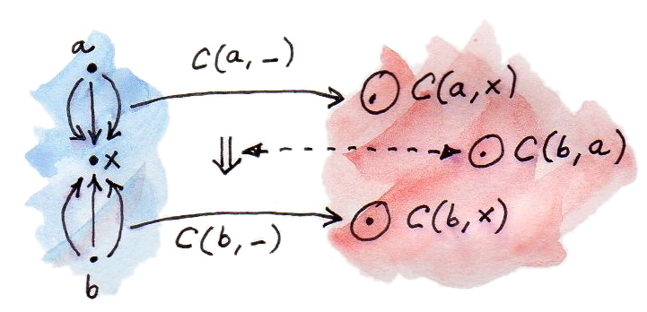
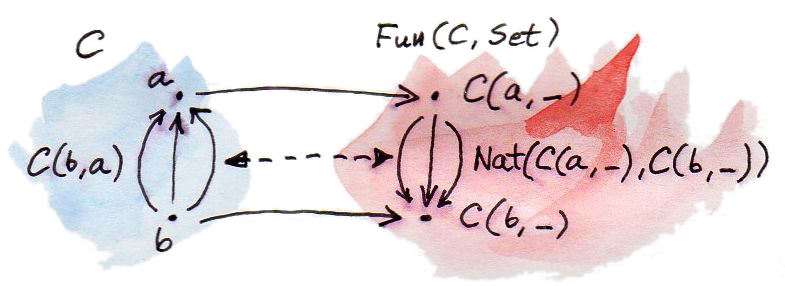

We’ve seen previously that, when we fix an object $`a`$ in the category $`\mathbf
{C}`$, the mapping $`\mathbf
{C}(a, -)`$ is a (covariant) functor from $`\mathbf
{C}`$ to $`\mathbf
{Set}`$.
``` math
x \to 
  \mathbf
{C}(a, x)
```
(The codomain is $`\mathbf
{Set}`$ because the hom-set $`\mathbf
{C}(a, x)`$ is a *set*.) We call this mapping a hom-functor — we have previously defined its action on morphisms as well.

Now let’s vary $`a`$ in this mapping. We get a new mapping that assigns the hom-*functor* $`\mathbf
{C}(a, -)`$ to any $`a`$.
``` math
a \to 
  \mathbf
{C}(a, -)
```
It’s a mapping of objects from category $`\mathbf
{C}`$ to functors, which are *objects* in the functor category (see the section about functor categories in Natural Transformations). Let’s use the notation $`[
  \mathbf
{C}, 
  \mathbf
{Set}]`$ for the functor category from $`\mathbf
{C}`$ to $`\mathbf
{Set}`$. You may also recall that hom-functors are the prototypical representable functors.

Every time we have a mapping of objects between two categories, it’s natural to ask if such a mapping is also a functor. In other words whether we can lift a morphism from one category to a morphism in the other category. A morphism in $`\mathbf
{C}`$ is just an element of $`\mathbf
{C}(a, b)`$, but a morphism in the functor category $`[
  \mathbf
{C}, 
  \mathbf
{Set}]`$ is a natural transformation. So we are looking for a mapping of morphisms to natural transformations.

Let’s see if we can find a natural transformation corresponding to a morphism $`f ::a \to b`$. First, let’s see what $`a`$ and $`b`$ are mapped to. They are mapped to two functors: $`\mathbf
{C}(a, -)`$ and $`\mathbf
{C}(b, -)`$. We need a natural transformation between those two functors.

And here’s the trick: we use the Yoneda lemma:
``` math
[
  \mathbf
{C}, 
  \mathbf
{Set}](
  \mathbf
{C}(a, -), F) \cong F a
```
and replace the generic $`F`$ with the hom-functor $`\mathbf
{C}(b, -)`$. We get:
``` math
[
  \mathbf
{C}, 
  \mathbf
{Set}](
  \mathbf
{C}(a, -), 
  \mathbf
{C}(b, -)) \cong 
  \mathbf
{C}(b, a)
```



*This is exactly the natural transformation between the two hom-functors we were looking for, but with a little twist: We have a mapping between a natural transformation and a morphism — an element of $`\mathbf*
{C}(b, a)`$ — that goes in the “wrong” direction. But that’s okay; it only means that the functor we are looking at is contravariant.



*Actually, we’ve got even more than we bargained for. The mapping from $`\mathbf*
{C}`$ to $`[
  \mathbf
{C}, 
  \mathbf
{Set}]`$ is not only a contravariant functor — it is a *fully faithful* functor. Fullness and faithfulness are properties of functors that describe how they map hom-sets.

A *faithful* functor is *injective* on hom-sets, meaning that it maps distinct morphisms to distinct morphisms. In other words, it doesn’t coalesce them.

A *full* functor is *surjective* on hom-sets, meaning that it maps one hom-set *onto* the other hom-set, fully covering the latter.

A fully faithful functor $`F`$ is a *bijection* on hom-sets — a one to one matching of all elements of both sets. For every pair of objects $`a`$ and $`b`$ in the source category $`\mathbf
{C}`$ there is a bijection between $`\mathbf
{C}(a, b)`$ and $`\mathbf
{D}(F a, F b)`$, where $`\mathbf
{D}`$ is the target category of $`F`$ (in our case, the functor category, $`[
  \mathbf
{C}, 
  \mathbf
{Set}]`$). Notice that this doesn’t mean that $`F`$ is a bijection on *objects*. There may be objects in $`\mathbf
{D}`$ that are not in the image of $`F`$, and we can’t say anything about hom-sets for those objects.

# The Embedding

The (contravariant) functor we have just described, the functor that maps objects in $`\mathbf
{C}`$ to functors in $`[
  \mathbf
{C}, 
  \mathbf
{Set}]`$:
``` math
a \to 
  \mathbf
{C}(a, -)
```
defines the *Yoneda embedding*. It *embeds* a category $`\mathbf
{C}`$ (strictly speaking, the category $`\mathbf
{C}^\mathit{op}`$, because of contravariance) inside the functor category $`[
  \mathbf
{C}, 
  \mathbf
{Set}]`$. It not only maps objects in $`\mathbf
{C}`$ to functors, but also faithfully preserves all connections between them.

This is a very useful result because mathematicians know a lot about the category of functors, especially functors whose codomain is $`\mathbf
{Set}`$. We can get a lot of insight about an arbitrary category $`\mathbf
{C}`$ by embedding it in the functor category.

Of course there is a dual version of the Yoneda embedding, sometimes called the co-Yoneda embedding. Observe that we could have started by fixing the target object (rather than the source object) of each hom-set, $`\mathbf
{C}(-, a)`$. That would give us a contravariant hom-functor. Contravariant functors from $`\mathbf
{C}`$ to $`\mathbf
{Set}`$ are our familiar presheaves (see, for instance, Limits and Colimits). The co-Yoneda embedding defines the embedding of a category $`\mathbf
{C}`$ in the category of presheaves. Its action on morphisms is given by:
``` math
[
  \mathbf
{C}^\mathit{op}, 
  \mathbf
{Set}](
  \mathbf
{C}(-, a), 
  \mathbf
{C}(-, b)) \cong 
  \mathbf
{C}(a, b)
```
Again, mathematicians know a lot about the category of presheaves, so being able to embed an arbitrary category in it is a big win.

# Application to Haskell

In Haskell, the Yoneda embedding can be represented as the isomorphism between natural transformations amongst reader functors on the one hand, and functions (going in the opposite direction) on the other hand:

``` text
forall x. (a -> x) -> (b -> x) \ensuremath{\cong} b -> a
```

(Remember, the reader functor is equivalent to `((->) a)`.)

The left hand side of this identity is a polymorphic function that, given a function from `a` to `x` and a value of type `b`, can produce a value of type `x` (I’m uncurrying — dropping the parentheses around — the function `b -> x`). The only way this can be done for all `x` is if our function knows how to convert a `b` to an `a`. It has to secretly have access to a function `b -> a`.

Given such a converter, `btoa`, one can define the left hand side, call it `fromY`, as:

``` haskell
fromY :: (a -> x) -> b -> x
fromY f b = f (btoa b)
```

Conversely, given a function `fromY` we can recover the converter by calling `fromY` with the identity:

``` haskell
fromY id :: b -> a
```

This establishes the bijection between functions of the type `fromY` and `btoa`.

An alternative way of looking at this isomorphism is that it’s a encoding of a function from `b` to `a`. The argument `a -> x` is a continuation (the handler). The result is a function from `b` to `x` which, when called with a value of type `b`, will execute the continuation precomposed with the function being encoded.

The Yoneda embedding also explains some of the alternative representations of data structures in Haskell. In particular, it provides a [very useful representation](https://bartoszmilewski.com/2015/07/13/from-lenses-to-yoneda-embedding/) of lenses from the `Control.Lens` library.

# Preorder Example

This example was suggested by Robert Harper. It’s the application of the Yoneda embedding to a category defined by a preorder. A preorder is a set with an ordering relation between its elements that’s traditionally written as $`\leqslant`$ (less than or equal). The “pre” in preorder is there because we’re only requiring the relation to be transitive and reflexive but not necessarily antisymmetric (so it’s possible to have cycles).

A set with the preorder relation gives rise to a category. The objects are the elements of this set. A morphism from object $`a`$ to $`b`$ either doesn’t exist, if the objects cannot be compared or if it’s not true that $`a \leqslant b`$; or it exists if $`a \leqslant b`$, and it points from $`a`$ to $`b`$. There is never more than one morphism from one object to another. Therefore any hom-set in such a category is either an empty set or a one-element set. Such a category is called *thin*.

It’s easy to convince yourself that this construction is indeed a category: The arrows are composable because, if $`a \leqslant b`$ and $`b \leqslant c`$ then $`a \leqslant c`$; and the composition is associative. We also have the identity arrows because every element is (less than or) equal to itself (reflexivity of the underlying relation).

We can now apply the co-Yoneda embedding to a preorder category. In particular, we’re interested in its action on morphisms:
``` math
[
  \mathbf
{C}, 
  \mathbf
{Set}](
  \mathbf
{C}(-, a), 
  \mathbf
{C}(-, b)) \cong 
  \mathbf
{C}(a, b)
```
The hom-set on the right hand side is non-empty if and only if $`a \leqslant b`$ — in which case it’s a one-element set. Consequently, if $`a \leqslant b`$, there exists a single natural transformation on the left. Otherwise there is no natural transformation.

So what’s a natural transformation between hom-functors in a preorder? It should be a family of functions between sets $`\mathbf
{C}(-, a)`$ and $`\mathbf
{C}(-, b)`$. In a preorder, each of these sets can either be empty or a singleton. Let’s see what kind of functions are there at our disposal.

There is a function from an empty set to itself (the identity acting on an empty set), a function `absurd` from an empty set to a singleton set (it does nothing, since it only needs to be defined for elements of an empty set, of which there are none), and a function from a singleton to itself (the identity acting on a one-element set). The only combination that is forbidden is the mapping from a singleton to an empty set (what would the value of such a function be when acting on the single element?).

So our natural transformation will never connect a singleton hom-set to an empty hom-set. In other words, if $`x \leqslant a`$ (singleton hom-set $`\mathbf
{C}(x, a)`$) then $`\mathbf
{C}(x, b)`$ cannot be empty. A non-empty $`\mathbf
{C}(x, b)`$ means that $`x`$ is less or equal to $`b`$. So the existence of the natural transformation in question requires that, for every $`x`$, if $`x \leqslant a`$ then $`x \leqslant b`$.
``` math
\text{for all } x, x \leqslant a \Rightarrow x \leqslant b
```
On the other hand, co-Yoneda tells us that the existence of this natural transformation is equivalent to $`\mathbf
{C}(a, b)`$ being non-empty, or to $`a \leqslant b`$. Together, we get:
``` math
a \leqslant b \text{ if and only if for all } x, x \leqslant a \Rightarrow x \leqslant b
```
We could have arrived at this result directly. The intuition is that, if $`a \leqslant b`$ then all elements that are below $`a`$ must also be below $`b`$. Conversely, when you substitute $`a`$ for $`x`$ on the right hand side, it follows that $`a \leqslant b`$. But you must admit that arriving at this result through the Yoneda embedding is much more exciting.

# Naturality

The Yoneda lemma establishes the isomorphism between the set of natural transformations and an object in $`\mathbf
{Set}`$. Natural transformations are morphisms in the functor category $`[
  \mathbf
{C}, 
  \mathbf
{Set}]`$. The set of natural transformation between any two functors is a hom-set in that category. The Yoneda lemma is the isomorphism:
``` math
[
  \mathbf
{C}, 
  \mathbf
{Set}](
  \mathbf
{C}(a, -), F) \cong F a
```
This isomorphism turns out to be natural in both $`F`$ and $`a`$. In other words, it’s natural in $`(F, a)`$, a pair taken from the product category $`[
  \mathbf
{C}, 
  \mathbf
{Set}] \times 
  \mathbf
{C}`$. Notice that we are now treating $`F`$ as an *object* in the functor category.

Let’s think for a moment what this means. A natural isomorphism is an invertible *natural transformation* between two functors. And indeed, the right hand side of our isomorphism is a functor. It’s a functor from $`[
  \mathbf
{C}, 
  \mathbf
{Set}] \times 
  \mathbf
{C}`$ to $`\mathbf
{Set}`$. Its action on a pair $`(F, a)`$ is a set — the result of evaluating the functor $`F`$ at the object $`a`$. This is called the evaluation functor.

The left hand side is also a functor that takes $`(F, a)`$ to a set of natural transformations $`[
  \mathbf
{C}, 
  \mathbf
{Set}](
  \mathbf
{C}(a, -), F)`$.

To show that these are really functors, we should also define their action on morphisms. But what’s a morphism between a pair $`(F, a)`$ and $`(G, b)`$? It’s a pair of morphisms, $`(\Phi, f)`$; the first being a morphism between functors — a natural transformation — the second being a regular morphism in $`\mathbf
{C}`$.

The evaluation functor takes this pair $`(\Phi, f)`$ and maps it to a function between two sets, $`F a`$ and $`G b`$. We can easily construct such a function from the component of $`\Phi`$ at $`a`$ (which maps $`F a`$ to $`G a`$) and the morphism $`f`$ lifted by $`G`$:
``` math
(G f) \circ \Phi_a
```
Notice that, because of naturality of $`\Phi`$, this is the same as:
``` math
\Phi_b \circ (F f)
```
I’m not going to prove the naturality of the whole isomorphism — after you’ve established what the functors are, the proof is pretty mechanical. It follows from the fact that our isomorphism is built up from functors and natural transformations. There is simply no way for it to go wrong.

# Challenges

1.  Express the co-Yoneda embedding in Haskell.

2.  Show that the bijection we established between `fromY` and `btoa` is an isomorphism (the two mappings are the inverse of each other).

3.  Work out the Yoneda embedding for a monoid. What functor corresponds to the monoid’s single object? What natural transformations correspond to monoid morphisms?

4.  What is the application of the *covariant* Yoneda embedding to preorders? (Question suggested by Gershom Bazerman.)

5.  Yoneda embedding can be used to embed an arbitrary functor category $`[
      \mathbf
    {C}, 
      \mathbf
    {D}]`$ in the functor category $`[[
      \mathbf
    {C}, 
      \mathbf
    {D}], 
      \mathbf
    {Set}]`$. Figure out how it works on morphisms (which in this case are natural transformations).
