So far we’ve been mostly working with a single category or a pair of categories. In some cases that was a little too constraining.

For instance, when defining a limit in a category $`\mathbf
{C}`$, we introduced an index category $`\mathbf
{I}`$ as the template for the pattern that would form the basis for our cones. It would have made sense to introduce another category, a trivial one, to serve as a template for the apex of the cone. Instead we used the constant functor $`\Delta_c`$ from $`\mathbf
{I}`$ to $`\mathbf
{C}`$.

It’s time to fix this awkwardness. Let’s define a limit using three categories. Let’s start with the functor $`D`$ from the index category $`\mathbf
{I}`$ to $`\mathbf
{C}`$. This is the functor that selects the base of the cone — the diagram functor.

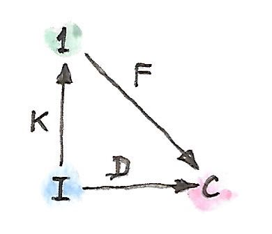

*The new addition is the category $`\mathbf*
{1}`$ that contains a single object (and a single identity morphism). There is only one possible functor $`K`$ from $`\mathbf
{I}`$ to this category. It maps all objects to the only object in $`\mathbf
{1}`$, and all morphisms to the identity morphism. Any functor $`F`$ from $`\mathbf
{1}`$ to $`\mathbf
{C}`$ picks a potential apex for our cone.

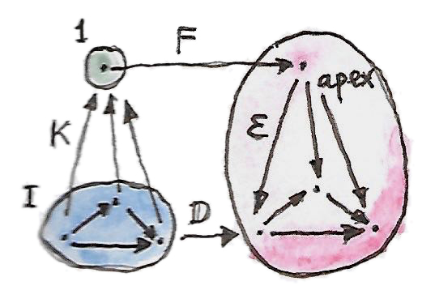

*A cone is a natural transformation $`\varepsilon`$ from $`F \circ K`$ to $`D`$. Notice that $`F \circ K`$ does exactly the same thing as our original $`\Delta_c`$. The following diagram shows this transformation.*

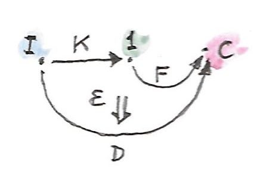

*We can now define a universal property that picks the “best” such functor $`F`$. This $`F`$ will map $`\mathbf*
{1}`$ to the object that is the limit of $`D`$ in $`\mathbf
{C}`$, and the natural transformation $`\varepsilon`$ from $`F \circ K`$ to $`D`$ will provide the corresponding projections. This universal functor is called the right Kan extension of $`D`$ along $`K`$ and is denoted by $`\mathbf{Ran}_{K}D`$.

Let’s formulate the universal property. Suppose we have another cone — that is another functor $`F'`$ together with a natural transformation $`\varepsilon'`$ from $`F' \circ K`$ to $`D`$.

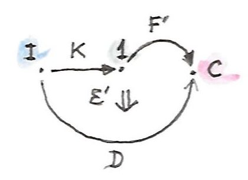

*If the Kan extension $`F = Ran_{K}D`$ exists, there must be a unique natural transformation $`\sigma`$ from $`F'`$ to it, such that $`\varepsilon'`$ factorizes through $`\varepsilon`$, that is:*
``` math
\varepsilon' = \varepsilon \cdot (\sigma \circ K)
```
Here, $`\sigma \circ K`$ is the horizontal composition of two natural transformations (one of them being the identity natural transformation on $`K`$). This transformation is then vertically composed with $`\varepsilon`$.

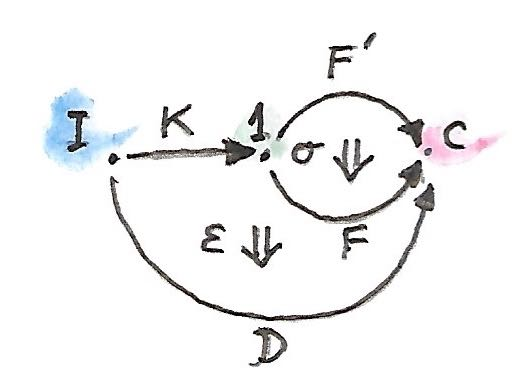

*In components, when acting on an object $`i`$ in $`\mathbf*
{I}`$, we get:
``` math
\varepsilon'_i = \varepsilon_i \circ \sigma_{K i}
```
In our case, $`\sigma`$ has only one component corresponding to the single object of $`\mathbf
{1}`$. So, indeed, this is the unique morphism from the apex of the cone defined by $`F'`$ to the apex of the universal cone defined by $`\mathbf{Ran}_{K}D`$. The commuting conditions are exactly the ones required by the definition of a limit.

But, importantly, we are free to replace the trivial category $`\mathbf
{1}`$ with an arbitrary category $`\mathbf
{A}`$, and the definition of the right Kan extension remains valid.

# Right Kan Extension

The right Kan extension of the functor $`D ::
  \mathbf
{I} \to 
  \mathbf
{C}`$ along the functor $`K ::
  \mathbf
{I} \to 
  \mathbf
{A}`$ is a functor $`F ::
  \mathbf
{A} \to 
  \mathbf
{C}`$ (denoted $`\mathbf{Ran}_{K}D`$) together with a natural transformation
``` math
\varepsilon ::F \circ K \to D
```
such that for any other functor $`F' ::
  \mathbf
{A} \to 
  \mathbf
{C}`$ and a natural transformation
``` math
\varepsilon' ::F' \circ K \to D
```
there is a unique natural transformation
``` math
\sigma ::F' \to F
```
that factorizes $`\varepsilon'`$:
``` math
\varepsilon' = \varepsilon \cdot (\sigma \circ K)
```
This is quite a mouthful, but it can be visualized in this nice diagram:

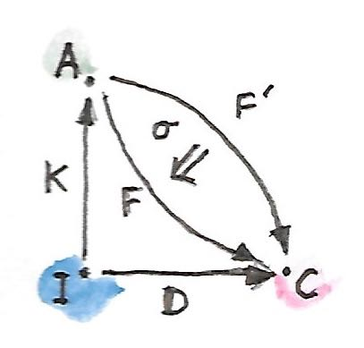

*An interesting way of looking at this is to notice that, in a sense, the Kan extension acts like the inverse of “functor multiplication.” Some authors go as far as use the notation $`D/K`$ for $`\mathbf{Ran}_{K}D`$. Indeed, in this notation, the definition of $`\varepsilon`$, which is also called the counit of the right Kan extension, looks like simple cancellation:*
``` math
\varepsilon ::D/K \circ K \to D
```
There is another interpretation of Kan extensions. Consider that the functor $`K`$ embeds the category $`\mathbf
{I}`$ inside $`\mathbf
{A}`$. In the simplest case $`\mathbf
{I}`$ could just be a subcategory of $`\mathbf
{A}`$. We have a functor $`D`$ that maps $`\mathbf
{I}`$ to $`\mathbf
{C}`$. Can we extend $`D`$ to a functor $`F`$ that is defined on the whole of $`\mathbf
{A}`$? Ideally, such an extension would make the composition $`F \circ K`$ be isomorphic to $`D`$. In other words, $`F`$ would be extending the domain of $`D`$ to $`\mathbf
{A}`$. But a full-blown isomorphism is usually too much to ask, and we can do with just half of it, namely a one-way natural transformation $`\varepsilon`$ from $`F \circ K`$ to $`D`$. (The left Kan extension picks the other direction.)

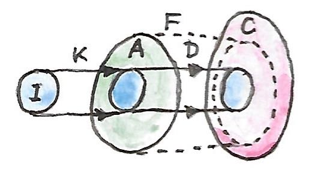

*Of course, the embedding picture breaks down when the functor $`K`$ is not injective on objects or not faithful on hom-sets, as in the example of the limit. In that case, the Kan extension tries its best to extrapolate the lost information.*

# Kan Extension as Adjunction

Now suppose that the right Kan extension exists for any $`D`$ (and a fixed $`K`$). In that case $`\mathbf{Ran}_{K}-`$ (with the dash replacing $`D`$) is a functor from the functor category $`{[}
  \mathbf
{I}, 
  \mathbf
{C}{]}`$ to the functor category $`{[}
  \mathbf
{A}, 
  \mathbf
{C}{]}`$. It turns out that this functor is the right adjoint to the precomposition functor $`- \circ K`$. The latter maps functors in $`{[}
  \mathbf
{A}, 
  \mathbf
{C}{]}`$ to functors in $`{[}
  \mathbf
{I}, 
  \mathbf
{C}{]}`$. The adjunction is:
``` math
[
  \mathbf
{I}, 
  \mathbf
{C}](F' \circ K, D) \cong [
  \mathbf
{A}, 
  \mathbf
{C}](F', \mathbf{Ran}_{K}D)
```
It is just a restatement of the fact that to every natural transformation we called $`\varepsilon'`$ corresponds a unique natural transformation we called $`\sigma`$.

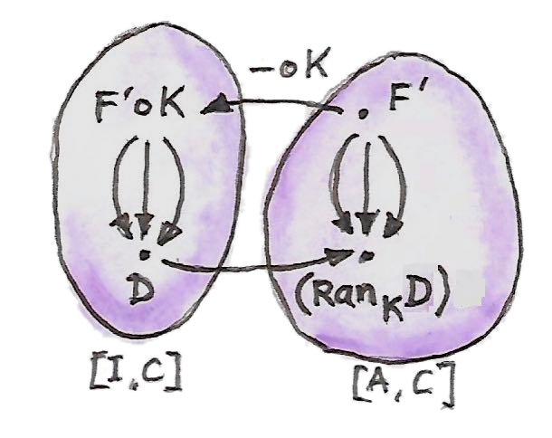

*Furthermore, if we chose the category $`\mathbf*
{I}`$ to be the same as $`\mathbf
{C}`$, we can substitute the identity functor $`I_{
  \mathbf
{C}}`$ for $`D`$. We get the following identity:
``` math
[
  \mathbf
{C}, 
  \mathbf
{C}](F' \circ K, I_{
  \mathbf
{C}}) \cong [
  \mathbf
{A}, 
  \mathbf
{C}](F', \mathbf{Ran}_{K}I_{
  \mathbf
{C}})
```
We can now chose $`F'`$ to be the same as $`\mathbf{Ran}_{K}I_{
  \mathbf
{C}}`$. In that case the right hand side contains the identity natural transformation and, corresponding to it, the left hand side gives us the following natural transformation:
``` math
\varepsilon ::\mathbf{Ran}_{K}I_{
  \mathbf
{C}} \circ K \to I_{
  \mathbf
{C}}
```
This looks very much like the counit of an adjunction:
``` math
\mathbf{Ran}_{K}I_{
  \mathbf
{C}} \dashv K
```
Indeed, the right Kan extension of the identity functor along a functor $`K`$ can be used to calculate the left adjoint of $`K`$. For that, one more condition is necessary: the right Kan extension must be preserved by the functor $`K`$. The preservation of the extension means that, if we calculate the Kan extension of the functor precomposed with $`K`$, we should get the same result as precomposing the original Kan extension with $`K`$. In our case, this condition simplifies to:
``` math
K \circ \mathbf{Ran}_{K}I_{
  \mathbf
{C}} \cong \mathbf{Ran}_{K}K
```
Notice that, using the division-by-$`K`$ notation, the adjunction can be written as:
``` math
I/K \dashv K
```
which confirms our intuition that an adjunction describes some kind of an inverse. The preservation condition becomes:
``` math
K \circ I/K \cong K/K
```
The right Kan extension of a functor along itself, $`K/K`$, is called a codensity monad.

The adjunction formula is an important result because, as we’ll see soon, we can calculate Kan extensions using ends (coends), thus giving us practical means of finding right (and left) adjoints.

# Left Kan Extension

There is a dual construction that gives us the left Kan extension. To build some intuition, we’ll start with the definition of a colimit and restructure it to use the singleton category $`\mathbf
{1}`$. We build a cocone by using the functor $`D ::
  \mathbf
{I} \to 
  \mathbf
{C}`$ to form its base, and the functor $`F ::
  \mathbf
{1} \to 
  \mathbf
{C}`$ to select its apex.

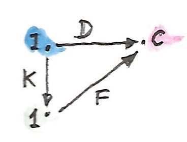

*The sides of the cocone, the injections, are components of a natural transformation $`\eta`$ from $`D`$ to $`F \circ K`$.*

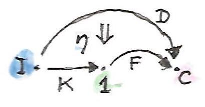

*The colimit is the universal cocone. So for any other functor $`F'`$ and a natural transformation*
``` math
\eta' ::D \to F' \circ K
```

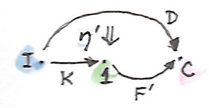

*there is a unique natural transformation $`\sigma`$ from $`F`$ to $`F'`$*

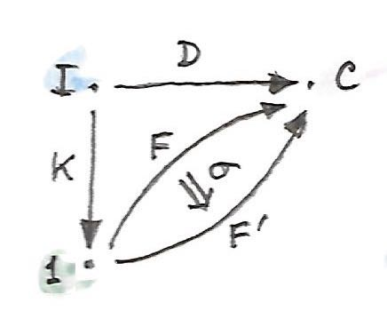

*such that:*
``` math
\eta' = (\sigma \circ K) \cdot \eta
```
This is illustrated in the following diagram:

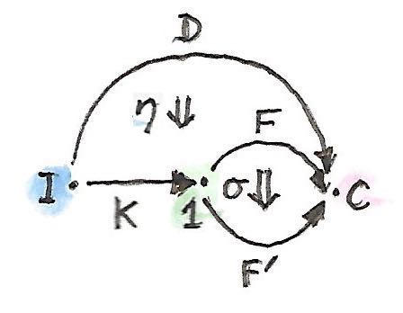

*Replacing the singleton category $`\mathbf*
{1}`$ with $`\mathbf
{A}`$, this definition naturally generalized to the definition of the left Kan extension, denoted by $`\mathbf{Lan}_{K}D`$.

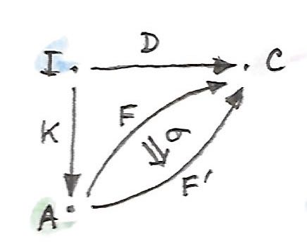

*The natural transformation:*
``` math
\eta ::D \to \mathbf{Lan}_{K}D \circ K
```
is called the unit of the left Kan extension.

As before, we can recast the one-to-one correspondence between natural transformations:
``` math
\eta' = (\sigma \circ K) \cdot \eta
```
in terms of the adjunction:
``` math
[
  \mathbf
{A}, 
  \mathbf
{C}](\mathbf{Lan}_{K}D, F') \cong [
  \mathbf
{I}, 
  \mathbf
{C}](D, F' \circ K)
```
In other words, the left Kan extension is the left adjoint, and the right Kan extension is the right adjoint of the precomposition with $`K`$.

Just like the right Kan extension of the identity functor could be used to calculate the left adjoint of $`K`$, the left Kan extension of the identity functor turns out to be the right adjoint of $`K`$ (with $`\eta`$ being the unit of the adjunction):
``` math
K \dashv \mathbf{Lan}_{K}I_{
  \mathbf
{C}}
```
Combining the two results, we get:
``` math
\mathbf{Ran}_{K}I_{
  \mathbf
{C}} \dashv K \dashv \mathbf{Lan}_{K}I_{
  \mathbf
{C}}
```

# Kan Extensions as Ends

The real power of Kan extensions comes from the fact that they can be calculated using ends (and coends). For simplicity, we’ll restrict our attention to the case where the target category $`\mathbf
{C}`$ is $`\mathbf
{Set}`$, but the formulas can be extended to any category.

Let’s revisit the idea that a Kan extension can be used to extend the action of a functor outside of its original domain. Suppose that $`K`$ embeds $`\mathbf
{I}`$ inside $`\mathbf
{A}`$. Functor $`D`$ maps $`\mathbf
{I}`$ to $`\mathbf
{Set}`$. We could just say that for any object $`a`$ in the image of $`K`$, that is $`a = K i`$, the extended functor maps $`a`$ to $`D i`$. The problem is, what to do with those objects in $`\mathbf
{A}`$ that are outside of the image of $`K`$? The idea is that every such object is potentially connected through lots of morphisms to every object in the image of $`K`$. A functor must preserve these morphisms. The totality of morphisms from an object $`a`$ to the image of $`K`$ is characterized by the hom-functor:
``` math
\mathbf
{A}(a, K -)
```

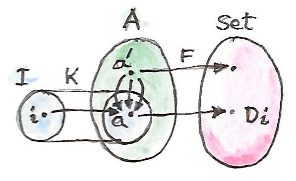

*Notice that this hom-functor is a composition of two functors:*
``` math
\mathbf
{A}(a, K -) = 
  \mathbf
{A}(a, -) \circ K
```
The right Kan extension is the right adjoint of functor composition:
``` math
[
  \mathbf
{I}, 
  \mathbf
{Set}](F' \circ K, D) \cong [
  \mathbf
{A}, 
  \mathbf
{Set}](F', \mathbf{Ran}_{K}D)
```
Let’s see what happens when we replace $`F'`$ with the hom functor:
``` math
[
  \mathbf
{I}, 
  \mathbf
{Set}](
  \mathbf
{A}(a, -) \circ K, D) \cong [
  \mathbf
{A}, 
  \mathbf
{Set}](
  \mathbf
{A}(a, -), \mathbf{Ran}_{K}D)
```
and then inline the composition:
``` math
[
  \mathbf
{I}, 
  \mathbf
{Set}](
  \mathbf
{A}(a, K -), D) \cong [
  \mathbf
{A}, 
  \mathbf
{Set}](
  \mathbf
{A}(a, -), \mathbf{Ran}_{K}D)
```
The right hand side can be reduced using the Yoneda lemma:
``` math
[
  \mathbf
{I}, 
  \mathbf
{Set}](
  \mathbf
{A}(a, K -), D) \cong \mathbf{Ran}_{K}D a
```
We can now rewrite the set of natural transformations as the end to get this very convenient formula for the right Kan extension:
``` math
\mathbf{Ran}_{K}D a \cong \int_i 
  \mathbf
{Set}(
  \mathbf
{A}(a, K i), D i)
```
There is an analogous formula for the left Kan extension in terms of a coend:
``` math
\mathbf{Lan}_{K}D a = \int^i 
  \mathbf
{A}(K i, a)\times{}D i
```
To see that this is the case, we’ll show that this is indeed the left adjoint to functor composition:
``` math
[
  \mathbf
{A}, 
  \mathbf
{Set}](\mathbf{Lan}_{K}D, F') \cong [
  \mathbf
{I}, 
  \mathbf
{Set}](D, F' \circ K)
```
Let’s substitute our formula in the left hand side:
``` math
[
  \mathbf
{A}, 
  \mathbf
{Set}](\int^i 
  \mathbf
{A}(K i, -)\times{}D i, F')
```
This is a set of natural transformations, so it can be rewritten as an end:
``` math
\int_a 
  \mathbf
{Set}(\int^i 
  \mathbf
{A}(K i, a)\times{}D i, F' a)
```
Using the continuity of the hom-functor, we can replace the coend with the end:
``` math
\int_a \int_i 
  \mathbf
{Set}(
  \mathbf
{A}(K i, a)\times{}D i, F' a)
```
We can use the product-exponential adjunction:
``` math
\int_a \int_i 
  \mathbf
{Set}(
  \mathbf
{A}(K i, a),\ (F' a)^{D i})
```
The exponential is isomorphic to the corresponding hom-set:
``` math
\int_a \int_i 
  \mathbf
{Set}(
  \mathbf
{A}(K i, a),\ 
  \mathbf
{Set}(D i, F' a))
```
There is a theorem called the Fubini theorem that allows us to swap the two ends:
``` math
\int_i \int_a 
  \mathbf
{Set}(
  \mathbf
{A}(K i, a),\ 
  \mathbf
{Set}(D i, F' a))
```
The inner end represents the set of natural transformations between two functors, so we can use the Yoneda lemma:
``` math
\int_i 
  \mathbf
{Set}(D i, F' (K i))
```
This is indeed the set of natural transformations that forms the right hand side of the adjunction we set out to prove:
``` math
[
  \mathbf
{I}, 
  \mathbf
{Set}](D, F' \circ K)
```
These kinds of calculations using ends, coends, and the Yoneda lemma are pretty typical for the “calculus” of ends.

# Kan Extensions in Haskell

The end/coend formulas for Kan extensions can be easily translated to Haskell. Let’s start with the right extension:
``` math
\mathbf{Ran}_{K}D a \cong \int_i 
  \mathbf
{Set}(
  \mathbf
{A}(a, K i), D i)
```
We replace the end with the universal quantifier, and hom-sets with function types:

``` haskell
newtype Ran k d a = Ran (forall i. (a -> k i) -> d i)
```

Looking at this definition, it’s clear that `Ran` must contain a value of type `a` to which the function can be applied, and a natural transformation between the two functors `k` and `d`. For instance, suppose that `k` is the tree functor, and `d` is the list functor, and you were given a `Ran Tree [] String`. If you pass it a function:

``` haskell
f :: String -> Tree Int
```

you’ll get back a list of `Int`, and so on. The right Kan extension will use your function to produce a tree and then repackage it into a list. For instance, you may pass it a parser that generates a parsing tree from a string, and you’ll get a list that corresponds to the depth-first traversal of this tree.

The right Kan extension can be used to calculate the left adjoint of a given functor by replacing the functor `d` with the identity functor. This leads to the left adjoint of a functor `k` being represented by the set of polymorphic functions of the type:

``` haskell
forall i. (a -> k i) -> i
```

Suppose that `k` is the forgetful functor from the category of monoids. The universal quantifier then goes over all monoids. Of course, in Haskell we cannot express monoidal laws, but the following is a decent approximation of the resulting free functor (the forgetful functor `k` is an identity on objects):

``` haskell
type Lst a = forall i. Monoid i => (a -> i) -> i
```

As expected, it generates free monoids, or Haskell lists:

``` haskell
toLst :: [a] -> Lst a
toLst as = \f -> foldMap f as

fromLst :: Lst a -> [a]
fromLst f = f (\a -> [a])
```

The left Kan extension is a coend:
``` math
\mathbf{Lan}_{K}D a = \int^i 
  \mathbf
{A}(K i, a)\times{}D i
```
so it translates to an existential quantifier. Symbolically:

``` haskell
Lan k d a = exists i. (k i -> a, d i)
```

This can be encoded in Haskell using s, or using a universally quantified data constructor:

``` haskell
data Lan k d a = forall i. Lan (k i -> a) (d i)
```

The interpretation of this data structure is that it contains a function that takes a container of some unspecified `i`s and produces an `a`. It also has a container of those `i`s. Since you have no idea what `i`s are, the only thing you can do with this data structure is to retrieve the container of `i`s, repack it into the container defined by the functor `k` using a natural transformation, and call the function to obtain the `a`. For instance, if `d` is a tree, and `k` is a list, you can serialize the tree, call the function with the resulting list, and obtain an `a`.

The left Kan extension can be used to calculate the right adjoint of a functor. We know that the right adjoint of the product functor is the exponential, so let’s try to implement it using the Kan extension:

``` haskell
type Exp a b = Lan ((,) a) Identity b
```

This is indeed isomorphic to the function type, as witnessed by the following pair of functions:

``` haskell
toExp :: (a -> b) -> Exp a b
toExp f = Lan (f . fst) (Identity ())

fromExp :: Exp a b -> (a -> b)
fromExp (Lan f (Identity x)) = \a -> f (a, x)
```

Notice that, as described earlier in the general case, we performed the following steps:

1.  Retrieved the container of `x` (here, it’s just a trivial identity container), and the function `f`.

2.  Repackaged the container using the natural transformation between the identity functor and the pair functor.

3.  Called the function `f`.

# Free Functor

An interesting application of Kan extensions is the construction of a free functor. It’s the solution to the following practical problem: suppose you have a type constructor — that is a mapping of objects. Is it possible to define a functor based on this type constructor? In other words, can we define a mapping of morphisms that would extend this type constructor to a full-blown endofunctor?

The key observation is that a type constructor can be described as a functor whose domain is a discrete category. A discrete category has no morphisms other than the identity morphisms. Given a category $`\mathbf
{C}`$, we can always construct a discrete category $`\mathbf
{|C|}`$ by simply discarding all non-identity morphisms. A functor $`F`$ from $`\mathbf
{|C|}`$ to $`\mathbf
{C}`$ is then a simple mapping of objects, or what we call a type constructor in Haskell. There is also a canonical functor $`J`$ that injects $`\mathbf
{|C|}`$ into $`\mathbf
{C}`$: it’s an identity on objects (and on identity morphisms). The left Kan extension of $`F`$ along $`J`$, if it exists, is then a functor for $`\mathbf
{C}`$ to $`\mathbf
{C}`$:
``` math
\mathbf{Lan}_{J}F a = \int^i 
  \mathbf
{C}(J i, a)\times{}F i
```
It’s called a free functor based on $`F`$.

In Haskell, we would write it as:

``` haskell
data FreeF f a = forall i. FMap (i -> a) (f i)
```

Indeed, for any type constructor `f`, `FreeF f` is a functor:

``` haskell
instance Functor (FreeF f) where
    fmap g (FMap h fi) = FMap (g . h) fi
```

As you can see, the free functor fakes the lifting of a function by recording both the function and its argument. It accumulates the lifted functions by recording their composition. Functor rules are automatically satisfied. This construction was used in a paper [Freer Monads, More Extensible Effects](http://okmij.org/ftp/Haskell/extensible/more.pdf).

Alternatively, we can use the right Kan extension for the same purpose:

``` haskell
newtype FreeF f a = FreeF (forall i. (a -> i) -> f i)
```

It’s easy to check that this is indeed a functor:

``` haskell
instance Functor (FreeF f) where
    fmap g (FreeF r) = FreeF (\bi -> r (bi . g))
```
