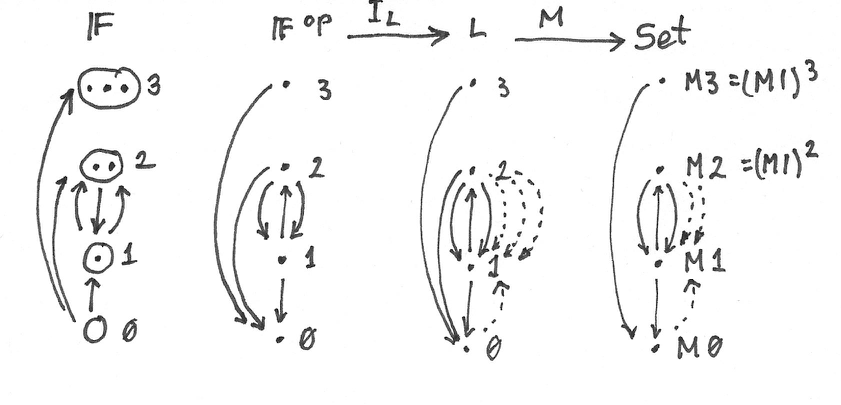
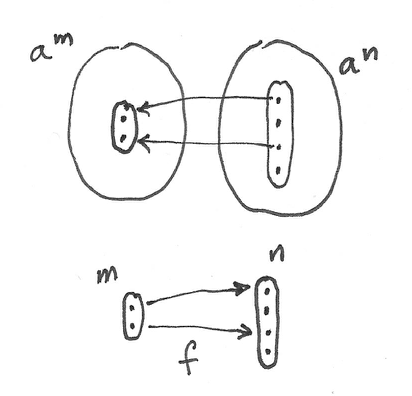

Nowadays you can’t talk about functional programming without mentioning monads. But there is an alternative universe in which, by chance, Eugenio Moggi turned his attention to Lawvere theories rather than monads. Let’s explore that universe.

# Universal Algebra

There are many ways of describing algebras at various levels of abstraction. We try to find a general language to describe things like monoids, groups, or rings. At the simplest level, all these constructions define *operations* on elements of a set, plus some *laws* that must be satisfied by these operations. For instance, a monoid can be defined in terms of a binary operation that is associative. We also have a unit element and unit laws. But with a little bit of imagination we can turn the unit element to a nullary operation — an operation that takes no arguments and returns a special element of the set. If we want to talk about groups, we add a unary operator that takes an element and returns its inverse. There are corresponding left and right inverse laws to go with it. A ring defines two binary operators plus some more laws. And so on.

The big picture is that an algebra is defined by a set of $`n`$-ary operations for various values of $`n`$, and a set of equational identities. These identities are all universally quantified. The associativity equation must be satisfied for all possible combinations of three elements, and so on.

Incidentally, this eliminates fields from consideration, for the simple reason that zero (unit with respect to addition) has no inverse with respect to multiplication. The inverse law for a field can’t be universally quantified.

This definition of a universal algebra can be extended to categories other than $`\mathbf
{Set}`$, if we replace operations (functions) with morphisms. Instead of a set, we select an object $`a`$ (called a generic object). A unary operation is just an endomorphism of $`a`$. But what about other arities (*arity* is the number of arguments for a given operation)? A binary operation (arity 2) can be defined as a morphism from the product $`a\times{}a`$ back to $`a`$. A general $`n`$-ary operation is a morphism from the $`n^\text{th}`$ power of $`a`$ to $`a`$:
``` math
\alpha_n ::a^n \to a
```
A nullary operation is a morphism from the terminal object (the zeroth power of $`a`$). So all we need in order to define any algebra is a category whose objects are powers of one special object $`a`$. The specific algebra is encoded in the hom-sets of this category. This is a Lawvere theory in a nutshell.

The derivation of Lawvere theories goes through many steps, so here’s the roadmap:

1.  Category of finite sets $`\mathbf
    {FinSet}`$.

2.  Its skeleton $`\mathbf
    {F}`$.

3.  Its opposite $`\mathbf
    {F}^\mathit{op}`$.

4.  Lawvere theory $`\mathbf
    {L}`$: an object in the category $`\mathbf
    {Law}`$.

5.  Model $`M`$ of a Lawvere category: an object in the category  
    $`\mathbf
    {Mod}(
      \mathbf
    {L}, 
      \mathbf
    {Set})`$.



*# Lawvere Theories*

All Lawvere theories share a common backbone. All objects in a Lawvere theory are generated from just one object using products (really, just powers). But how do we define these products in a general category? It turns out that we can define products using a mapping from a simpler category. In fact this simpler category may define coproducts instead of products, and we’ll use a *contravariant* functor to embed them in our target category. A contravariant functor turns coproducts into products and injections to projections.

The natural choice for the backbone of a Lawvere category is the category of finite sets, $`\mathbf
{FinSet}`$. It contains the empty set $`\varnothing`$, a singleton set $`1`$, a two-element set $`2`$, and so on. All objects in this category can be generated from the singleton set using coproducts (treating the empty set as a special case of a nullary coproduct). For instance, a two-element set is a sum of two singletons, $`2 = 1 + 1`$, as expressed in Haskell:

``` haskell
type Two = Either () ()
```

However, even though it’s natural to think that there’s only one empty set, there may be many distinct singleton sets. In particular, the set $`1 + \varnothing`$ is different from the set $`\varnothing + 1`$, and different from $`1`$ — even though they are all isomorphic. The coproduct in the category of sets is not associative. We can remedy that situation by building a category that identifies all isomorphic sets. Such a category is called a *skeleton*. In other words, the backbone of any Lawvere theory is the skeleton $`\mathbf
{F}`$ of $`\mathbf
{FinSet}`$. The objects in this category can be identified with natural numbers (including zero) that correspond to the element count in $`\mathbf
{FinSet}`$. Coproduct plays the role of addition. Morphisms in $`\mathbf
{F}`$ correspond to functions between finite sets. For instance, there is a unique morphism from $`\varnothing`$ to $`n`$ (empty set being the initial object), no morphisms from $`n`$ to $`\varnothing`$ (except $`\varnothing \to \varnothing`$), $`n`$ morphisms from $`1`$ to $`n`$ (the injections), one morphism from $`n`$ to $`1`$, and so on. Here, $`n`$ denotes an object in $`\mathbf
{F}`$ corresponding to all $`n`$-element sets in $`\mathbf
{FinSet}`$ that have been identified through isomorphisms.

Using the category $`\mathbf
{F}`$ we can formally define a *Lawvere theory* as a category $`\mathbf
{L}`$ equipped with a special functor:
``` math
I_{
  \mathbf
{L}} ::
  \mathbf
{F}^\mathit{op}\to 
  \mathbf
{L}
```
This functor must be a bijection on objects and it must preserve finite products (products in $`\mathbf
{F}^\mathit{op}`$ are the same as coproducts in $`\mathbf
{F}`$):
``` math
I_{
  \mathbf
{L}} (m\times{}n) = I_{
  \mathbf
{L}} m\times{}I_{
  \mathbf
{L}} n
```
You may sometimes see this functor characterized as identity-on-objects, which means that the objects in $`\mathbf
{F}`$ and $`\mathbf
{L}`$ are the same. We will therefore use the same names for them — we’ll denote them by natural numbers. Keep in mind though that objects in $`\mathbf
{F}`$ are not the same as sets (they are classes of isomorphic sets).

The hom-sets in $`\mathbf
{L}`$ are, in general, richer than those in $`\mathbf
{F}^\mathit{op}`$. They may contain morphisms other than the ones corresponding to functions in $`\mathbf
{FinSet}`$ (the latter are sometimes called *basic product operations*). Equational laws of a Lawvere theory are encoded in those morphisms.

The key observation is that the singleton set $`1`$ in $`\mathbf
{F}`$ is mapped to some object that we also call $`1`$ in $`\mathbf
{L}`$, and all the other objects in $`\mathbf
{L}`$ are automatically powers of this object. For instance, the two-element set $`2`$ in $`\mathbf
{F}`$ is the coproduct $`1 + 1`$, so it must be mapped to a product $`1 \times 1`$ (or $`1^2`$) in $`\mathbf
{L}`$. In this sense, the category $`\mathbf
{F}`$ behaves like the logarithm of $`\mathbf
{L}`$.

Among morphisms in $`\mathbf
{L}`$ we have those transferred by the functor $`I_{
  \mathbf
{L}}`$ from $`\mathbf
{F}`$. They play a structural role in $`\mathbf
{L}`$. In particular coproduct injections $`i_k`$ become product projections $`p_k`$. A useful intuition is to imagine the projection:
``` math
p_k ::1^n \to 1
```
as the prototype for a function of $`n`$ variables that ignores all but the $`k^\text{th}`$ variable. Conversely, constant morphisms $`n \to 1`$ in $`\mathbf
{F}`$ become diagonal morphisms $`1 \to 1^n`$ in $`\mathbf
{L}`$. They correspond to duplication of variables.

The interesting morphisms in $`\mathbf
{L}`$ are the ones that define $`n`$-ary operations other than projections. It’s those morphisms that distinguish one Lawvere theory from another. These are the multiplications, the additions, the selections of unit elements, and so on, that define the algebra. But to make $`\mathbf
{L}`$ a full category, we also need compound operations $`n \to m`$ (or, equivalently, $`1^n \to 1^m`$). Because of the simple structure of the category, they turn out to be products of simpler morphisms of the type $`n \to 1`$. This is a generalization of the statement that a function that returns a product is a product of functions; as we’ve seen earlier, the hom-functor is continuous.


*Lawvere theory $`\mathbf*
{L}`$ is based on $`\mathbf
{F}^\mathit{op}`$, from which it inherits the “boring” morphisms that define the products. It adds the “interesting” morphisms that describe the $`n`$-ary operations (dotted arrows).

Lawvere theories form a category $`\mathbf
{Law}`$, in which morphisms are functors that preserve finite products and commute with the functors $`I`$. Given two such theories, $`(
  \mathbf
{L}, I_{
  \mathbf
{L}})`$ and $`(
  \mathbf
{L'}, I'_{
  \mathbf
{L'}})`$, a morphism between them is a functor $`F ::
  \mathbf
{L} \to 
  \mathbf
{L'}`$ such that:
``` math
\begin{gathered}
  F (m \times n) = F m \times F n \\
  F \circ I_{
  \mathbf
{L}} = I'_{
  \mathbf
{L'}}
\end{gathered}
```
Morphisms between Lawvere theories encapsulate the idea of the interpretation of one theory inside another. For instance, group multiplication may be interpreted as monoid multiplication if we ignore inverses.

The simplest trivial example of a Lawvere category is $`\mathbf
{F}^\mathit{op}`$ itself (corresponding to the choice of the identity functor for $`I_{
  \mathbf
{L}}`$). This Lawvere theory that has no operations or laws happens to be the initial object in $`\mathbf
{Law}`$.

At this point it would be very helpful to present a non-trivial example of a Lawvere theory, but it would be hard to explain it without first understanding what models are.

# Models of Lawvere Theories

The key to understand Lawvere theories is to realize that one such theory generalizes a lot of individual algebras that share the same structure. For instance, the Lawvere theory of monoids describes the essence of being a monoid. It must be valid for all monoids. A particular monoid becomes a model of such a theory. A model is defined as a functor from the Lawvere theory $`\mathbf
{L}`$ to the category of sets $`\mathbf
{Set}`$. (There are generalizations of Lawvere theories that use other categories for models but here I’ll just concentrate on $`\mathbf
{Set}`$.) Since the structure of $`\mathbf
{L}`$ depends heavily on products, we require that such a functor preserve finite products. A model of $`\mathbf
{L}`$, also called the algebra over the Lawvere theory $`\mathbf
{L}`$, is therefore defined by a functor:
``` math
\begin{gathered}
  M ::
  \mathbf
{L} \to 
  \mathbf
{Set}\\
  M (a \times b) \cong M a \times M b
\end{gathered}
```
Notice that we require the preservation of products only *up to isomorphism*. This is very important, because strict preservation of products would eliminate most interesting theories.

The preservation of products by models means that the image of $`M`$ in $`\mathbf
{Set}`$ is a sequence of sets generated by powers of the set $`M 1`$ — the image of the object $`1`$ from $`\mathbf
{L}`$. Let’s call this set $`a`$. (This set is sometimes called a *sort*, and such an algebra is called *single-sorted*. There exist generalizations of Lawvere theories to multi-sorted algebras.) In particular, binary operations from $`\mathbf
{L}`$ are mapped to functions:
``` math
a \times a \to a
```
As with any functor, it’s possible that multiple morphisms in $`\mathbf
{L}`$ are collapsed to the same function in $`\mathbf
{Set}`$.

Incidentally, the fact that all laws are universally quantified equalities means that every Lawvere theory has a trivial model: a constant functor mapping all objects to the singleton set, and all morphisms to the identity function on it.

A general morphism in $`\mathbf
{L}`$ of the form $`m \to n`$ is mapped to a function:
``` math
a^m \to a^n
```
If we have two different models, $`M`$ and $`N`$, a natural transformation between them is a family of functions indexed by $`n`$:
``` math
\mu_n ::M n \to N n
```
or, equivalently:
``` math
\mu_n ::a^n \to b^n
```
where $`b = N 1`$.

Notice that the naturality condition guarantees the preservation of $`n`$-ary operations:
``` math
N f \circ \mu_n = \mu_1 \circ M f
```
where $`f ::n \to 1`$ is an $`n`$-ary operation in $`\mathbf
{L}`$.

The functors that define models form a category of models, $`\mathbf
{Mod}(
  \mathbf
{L}, 
  \mathbf
{Set})`$, with natural transformations as morphisms.

Consider a model for the trivial Lawvere category $`\mathbf
{F}^\mathit{op}`$. Such a model is completely determined by its value at $`1`$, $`M 1`$. Since $`M 1`$ can be any set, there are as many of these models as there are sets in $`\mathbf
{Set}`$. Moreover, every morphism in $`\mathbf
{Mod}(
  \mathbf
{F}^\mathit{op}, 
  \mathbf
{Set})`$ (a natural transformation between functors $`M`$ and $`N`$) is uniquely determined by its component at $`1`$. Conversely, every function $`M 1 \to N 1`$ induces a natural transformation between the two models $`M`$ and $`N`$. Therefore $`\mathbf
{Mod}(
  \mathbf
{F}^\mathit{op}, 
  \mathbf
{Set})`$ is equivalent to $`\mathbf
{Set}`$.

# The Theory of Monoids

The simplest nontrivial example of a Lawvere theory describes the structure of monoids. It is a single theory that distills the structure of all possible monoids, in the sense that the models of this theory span the whole category $`\mathbf
{Mon}`$ of monoids. We’ve already seen a universal construction, which showed that every monoid can be obtained from an appropriate free monoid by identifying a subset of morphisms. So a single free monoid already generalizes a whole lot of monoids. There are, however, infinitely many free monoids. The Lawvere theory for monoids $`\mathbf
{L}_{
  \mathbf
{Mon}}`$ combines all of them in one elegant construction.

Every monoid must have a unit, so we have to have a special morphism $`\eta`$ in $`\mathbf
{L}_{
  \mathbf
{Mon}}`$ that goes from $`0`$ to $`1`$. Notice that there can be no corresponding morphism in $`\mathbf
{F}`$. Such a morphism would go in the opposite direction, from $`1`$ to $`0`$ which, in $`\mathbf
{FinSet}`$, would be a function from the singleton set to the empty set. No such function exists.

Next, consider morphisms $`2 \to 1`$, members of $`\mathbf
{L}_{
  \mathbf
{Mon}}(2, 1)`$, which must contain prototypes of all binary operations. When constructing models in $`\mathbf
{Mod}(
  \mathbf
{L}_{
  \mathbf
{Mon}}, 
  \mathbf
{Set})`$, these morphisms will be mapped to functions from the Cartesian product $`M 1 \times M 1`$ to $`M 1`$. In other words, functions of two arguments.

The question is: how many functions of two arguments can one implement using only the monoidal operator. Let’s call the two arguments $`a`$ and $`b`$. There is one function that ignores both arguments and returns the monoidal unit. Then there are two projections that return $`a`$ and $`b`$, respectively. They are followed by functions that return $`ab`$, $`ba`$, $`aa`$, $`bb`$, $`aab`$, and so on… In fact there are as many such functions of two arguments as there are elements in the free monoid with generators $`a`$ and $`b`$. Notice that $`\mathbf
{L}_{
  \mathbf
{Mon}}(2, 1)`$ must contain all those morphisms because one of the models is the free monoid. In a free monoid they correspond to distinct functions. Other models may collapse multiple morphisms in $`\mathbf
{L}_{
  \mathbf
{Mon}}(2, 1)`$ down to a single function, but not the free monoid.

If we denote the free monoid with $`n`$ generators $`n^*`$, we may identify the hom-set $`\mathbf
{L}(2, 1)`$ with the hom-set $`\mathbf
{Mon}(1^*, 2^*)`$ in $`\mathbf
{Mon}`$, the category of monoids. In general, we pick $`\mathbf
{L}_{
  \mathbf
{Mon}}(m, n)`$ to be $`\mathbf
{Mon}(n^*, m^*)`$. In other words, the category $`\mathbf
{L}_{
  \mathbf
{Mon}}`$ is the opposite of the category of free monoids.

The category of *models* of the Lawvere theory for monoids,  
$`\mathbf
{Mod}(
  \mathbf
{L}_{
  \mathbf
{Mon}}, 
  \mathbf
{Set})`$, is equivalent to the category of all monoids, $`\mathbf
{Mon}`$.

# Lawvere Theories and Monads

As you may remember, algebraic theories can be described using monads — in particular algebras for monads. It should be no surprise then that there is a connection between Lawvere theories and monads.

First, let’s see how a Lawvere theory induces a monad. It does it through an adjunction between a forgetful functor and a free functor. The forgetful functor $`U`$ assigns a set to each model. This set is given by evaluating the functor $`M`$ from $`\mathbf
{Mod}(
  \mathbf
{L}, 
  \mathbf
{Set})`$ at the object $`1`$ in $`\mathbf
{L}`$.

Another way of deriving $`U`$ is by exploiting the fact that $`\mathbf
{F}^\mathit{op}`$ is the initial object in $`\mathbf
{Law}`$. It means that, for any Lawvere theory $`\mathbf
{L}`$, there is a unique functor $`\mathbf
{F}^\mathit{op}\to 
  \mathbf
{L}`$. This functor induces the opposite functor on models (since models are functors *from* theories to sets):
``` math
\mathbf
{Mod}(
  \mathbf
{L}, 
  \mathbf
{Set}) \to 
  \mathbf
{Mod}(
  \mathbf
{F}^\mathit{op}, 
  \mathbf
{Set})
```
But, as we discussed, the category of models of $`\mathbf
{F}^\mathit{op}`$ is equivalent to $`\mathbf
{Set}`$, so we get the forgetful functor:
``` math
U ::
  \mathbf
{Mod}(
  \mathbf
{L}, 
  \mathbf
{Set}) \to 
  \mathbf
{Set}
```
It can be shown that so defined $`U`$ always has a left adjoint, the free functor $`F`$.

This is easily seen for finite sets. The free functor $`F`$ produces free algebras. A free algebra is a particular model in $`\mathbf
{Mod}(
  \mathbf
{L}, 
  \mathbf
{Set})`$ that is generated from a finite set of generators $`n`$. We can implement $`F`$ as the representable functor:
``` math
\mathbf
{L}(n, -) ::
  \mathbf
{L} \to 
  \mathbf
{Set}
```
To show that it’s indeed free, all we have to do is to prove that it’s a left adjoint to the forgetful functor:
``` math
\mathbf
{Mod}(
  \mathbf
{L}, 
  \mathbf
{Set})(
  \mathbf
{L}(n, -), M) \cong 
  \mathbf
{Set}(n, U(M))
```
Let’s simplify the right hand side:
``` math
\mathbf
{Set}(n, U(M)) \cong 
  \mathbf
{Set}(n, M 1) \cong (M 1)^n \cong M n
```
(I used the fact that a set of morphisms is isomorphic to the exponential which, in this case, is just the iterated product.) The adjunction is the result of the Yoneda lemma:
``` math
[
  \mathbf
{L}, 
  \mathbf
{Set}](
  \mathbf
{L}(n, -), M) \cong M n
```
Together, the forgetful and the free functor define a monad $`T = U \circ F`$ on $`\mathbf
{Set}`$. Thus every Lawvere theory generates a monad.

It turns out that the category of algebras for this monad is equivalent to the category of models.

You may recall that monad algebras define ways to evaluate expressions that are formed using monads. A Lawvere theory defines $`n`$-ary operations that can be used to generate expressions. Models provide means to evaluate these expressions.

The connection between monads and Lawvere theories doesn’t go both ways, though. Only finitary monads lead to Lawvere theories. A finitary monad is based on a finitary functor. A finitary functor on $`\mathbf
{Set}`$ is fully determined by its action on finite sets. Its action on an arbitrary set $`a`$ can be evaluated using the following coend:
``` math
F a = \int^n a^n \times (F n)
```
Since the coend generalizes a coproduct, or a sum, this formula is a generalization of a power series expansion. Or we can use the intuition that a functor is a generalized container. In that case a finitary container of $`a`$s can be described as a sum of shapes and contents. Here, $`F n`$ is a set of shapes for storing $`n`$ elements, and the contents is an $`n`$-tuple of elements, itself an element of $`a^n`$. For instance, a list (as a functor) is finitary, with one shape for every arity. A tree has more shapes per arity, and so on.

First off, all monads that are generated from Lawvere theories are finitary and they can be expressed as coends:
``` math
T_{
  \mathbf
{L}} a = \int^n a^n \times 
  \mathbf
{L}(n, 1)
```
Conversely, given any finitary monad $`T`$ on $`\mathbf
{Set}`$, we can construct a Lawvere theory. We start by constructing a Kleisli category for $`T`$. As you may remember, a morphism in a Kleisli category from $`a`$ to $`b`$ is given by a morphism in the underlying category:
``` math
a \to T b
```
When restricted to finite sets, this becomes:
``` math
m \to T n
```
The category opposite to this Kleisli category, $`\mathbf
{Kl}^\mathit{op}_{T}`$, restricted to finite sets, is the Lawvere theory in question. In particular, the hom-set $`\mathbf
{L}(n, 1)`$ that describes $`n`$-ary operations in $`\mathbf
{L}`$ is given by the hom-set $`\mathbf
{Kl}_{T}(1, n)`$.

It turns out that most monads that we encounter in programming are finitary, with the notable exception of the continuation monad. It is possible to extend the notion of Lawvere theory beyond finitary operations.

# Monads as Coends

Let’s explore the coend formula in more detail.
``` math
T_{
  \mathbf
{L}} a = \int^n a^n \times 
  \mathbf
{L}(n, 1)
```
To begin with, this coend is taken over a profunctor $`P`$ in $`\mathbf
{F}`$ defined as:
``` math
P n m = a^n \times 
  \mathbf
{L}(m, 1)
```
This profunctor is contravariant in the first argument, $`n`$. Consider how it lifts morphisms. A morphism in $`\mathbf
{FinSet}`$ is a mapping of finite sets $`f ::m \to n`$. Such a mapping describes a selection of $`m`$ elements from an $`n`$-element set (repetitions are allowed). It can be lifted to the mapping of powers of $`a`$, namely (notice the direction):
``` math
a^n \to a^m
```
The lifting simply selects $`m`$ elements from a tuple of $`n`$ elements  
$`(a_1, a_2, \ldots{}, a_n)`$ (possibly with repetitions).



*For instance, let’s take $`f_k ::1 \to n`$ — a selection of the $`k^\text{th}`$ element from an $`n`$-element set. It lifts to a function that takes a $`n`$-tuple of elements of $`a`$ and returns the $`k^\text{th}`$ one.*

Or let’s take $`f ::m \to 1`$ — a constant function that maps all $`m`$ elements to one. Its lifting is a function that takes a single element of $`a`$ and duplicates it $`m`$ times:
``` math
\lambda{}x \to (\underbrace{x, x, \ldots{}, x}_{m})
```
You might notice that it’s not immediately obvious that the profunctor in question is covariant in the second argument. The hom-functor $`\mathbf
{L}(m, 1)`$ is actually contravariant in $`m`$. However, we are taking the coend not in the category $`\mathbf
{L}`$ but in the category $`\mathbf
{F}`$. The coend variable $`n`$ goes over finite sets (or the skeletons of such). The category $`\mathbf
{L}`$ contains the opposite of $`\mathbf
{F}`$, so a morphism $`m \to n`$ in $`\mathbf
{F}`$ is a member of $`\mathbf
{L}(n, m)`$ in $`\mathbf
{L}`$ (the embedding is given by the functor $`I_{
  \mathbf
{L}}`$).

Let’s check the functoriality of $`\mathbf
{L}(m, 1)`$ as a functor from $`\mathbf
{F}`$ to $`\mathbf
{Set}`$. We want to lift a function $`f ::m \to n`$, so our goal is to implement a function from $`\mathbf
{L}(m, 1)`$ to $`\mathbf
{L}(n, 1)`$. Corresponding to the function $`f`$ there is a morphism in $`\mathbf
{L}`$ from $`n`$ to $`m`$ (notice the direction). Precomposing this morphism with $`\mathbf
{L}(m, 1)`$ gives us a subset of $`\mathbf
{L}(n, 1)`$.

Notice that, by lifting a function $`1 \to n`$ we can go from $`\mathbf
{L}(1, 1)`$ to $`\mathbf
{L}(n, 1)`$. We’ll use this fact later on.

The product of a contravariant functor $`a^n`$ and a covariant functor $`\mathbf
{L}(m, 1)`$ is a profunctor $`\mathbf
{F}^\mathit{op}\times 
  \mathbf
{F} \to 
  \mathbf
{Set}`$. Remember that a coend can be defined as a coproduct (disjoint sum) of all the diagonal members of a profunctor, in which some elements are identified. The identifications correspond to cowedge conditions.

Here, the coend starts as the disjoint sum of sets $`a^n \times 
  \mathbf
{L}(n, 1)`$ over all $`n`$s. The identifications can be generated by expressing the coend as a coequalizer. We start with an off-diagonal term $`a^n \times 
  \mathbf
{L}(m, 1)`$. To get to the diagonal, we can apply a morphism $`f ::m \to n`$ either to the first or the second component of the product. The two results are then identified.

I have shown before that the lifting of $`f ::1 \to n`$ results in these two transformations:
``` math
a^n \to a
```
and:
``` math
\mathbf
{L}(1, 1) \to 
  \mathbf
{L}(n, 1)
```
Therefore, starting from $`a^n \times 
  \mathbf
{L}(1, 1)`$ we can reach both:
``` math
a \times 
  \mathbf
{L}(1, 1)
```
when we lift $`\langle f, \mathbf{id}\rangle`$ and:
``` math
a^n \times 
  \mathbf
{L}(n, 1)
```
when we lift $`\langle \mathbf{id}, f \rangle`$. This doesn’t mean, however, that all elements of $`a^n \times 
  \mathbf
{L}(n, 1)`$ can be identified with $`a \times 
  \mathbf
{L}(1, 1)`$. That’s because not all elements of $`\mathbf
{L}(n, 1)`$ can be reached from $`\mathbf
{L}(1, 1)`$. Remember that we can only lift morphisms from $`\mathbf
{F}`$. A non-trivial $`n`$-ary operation in $`\mathbf
{L}`$ cannot be constructed by lifting a morphism $`f ::1 \to n`$.

In other words, we can only identify all addends in the coend formula for which $`\mathbf
{L}(n, 1)`$ can be reached from $`\mathbf
{L}(1, 1)`$ through the application of basic morphisms. They are all equivalent to $`a \times 
  \mathbf
{L}(1, 1)`$. Basic morphisms are the ones that are images of morphisms in $`\mathbf
{F}`$.

Let’s see how this works in the simplest case of the Lawvere theory, the $`\mathbf
{F}^\mathit{op}`$ itself. In such a theory, every $`\mathbf
{L}(n, 1)`$ can be reached from $`\mathbf
{L}(1, 1)`$. This is because $`\mathbf
{L}(1, 1)`$ is a singleton containing just the identity morphism, and $`\mathbf
{L}(n, 1)`$ only contains morphisms corresponding to injections $`1 \to n`$ in $`\mathbf
{F}`$, which *are* basic morphisms. Therefore all the addends in the coproduct are equivalent and we get:
``` math
T a = a \times 
  \mathbf
{L}(1, 1) = a
```
which is the identity monad.

# Lawvere Theory of Side Effects

Since there is such a strong connection between monads and Lawvere theories, it’s natural to ask the question if Lawvere theories could be used in programming as an alternative to monads. The major problem with monads is that they don’t compose nicely. There is no generic recipe for building monad transformers. Lawvere theories have an advantage in this area: they can be composed using coproducts and tensor products. On the other hand, only finitary monads can be easily converted to Lawvere theories. The outlier here is the continuation monad. There is ongoing research in this area (see bibliography).

To give you a taste of how a Lawvere theory can be used to describe side effects, I’ll discuss the simple case of exceptions that are traditionally implemented using the `Maybe` monad.

The `Maybe` monad is generated by the Lawvere theory with a single nullary operation $`0 \to 1`$. A model of this theory is a functor that maps $`1`$ to some set $`a`$, and maps the nullary operation to a function:

``` haskell
raise :: () -> a
```

We can recover the `Maybe` monad using the coend formula. Let’s consider what the addition of the nullary operation does to the hom-sets $`\mathbf
{L}(n, 1)`$. Besides creating a new element in $`\mathbf
{L}(0, 1)`$ (which is absent from $`\mathbf
{F}^\mathit{op}`$), it also adds new morphisms to $`\mathbf
{L}(n, 1)`$. These are the results of composing morphism of the type $`n \to 0`$ with our $`0 \to 1`$. Such contributions are all identified with $`a^0 \times 
  \mathbf
{L}(0, 1)`$ in the coend formula, because they can be obtained from:
``` math
a^n \times 
  \mathbf
{L}(0, 1)
```
by lifting $`0 \to n`$ in two different ways.

The coend reduces to:
``` math
T_{
  \mathbf
{L}} a = a^0 + a^1
```
or, using Haskell notation:

``` haskell
type Maybe a = Either () a
```

which is equivalent to:

``` haskell
data Maybe a = Nothing | Just a
```

Notice that this Lawvere theory only supports the raising of exceptions, not their handling.

# Challenges

1.  Enumerate all morphisms between $`2`$ and $`3`$ in $`\mathbf
    {F}`$ (the skeleton of $`\mathbf
    {FinSet}`$).

2.  Show that the category of models for the Lawvere theory of monoids is equivalent to the category of monad algebras for the list monad.

3.  The Lawvere theory of monoids generates the list monad. Show that its binary operations can be generated using the corresponding Kleisli arrows.

4.  $`\mathbf
    {FinSet}`$ is a subcategory of $`\mathbf
    {Set}`$ and there is a functor that embeds it in $`\mathbf
    {Set}`$. Any functor on $`\mathbf
    {Set}`$ can be restricted to $`\mathbf
    {FinSet}`$. Show that a finitary functor is the left Kan extension of its own restriction.

# Further Reading

1.  [Functorial Semantics of Algebraic Theories](http://www.tac.mta.ca/tac/reprints/articles/5/tr5.pdf), F. William Lawvere

2.  [Notions of computation determine monads](http://homepages.inf.ed.ac.uk/gdp/publications/Comp_Eff_Monads.pdf), Gordon Plotkin and John Power
