There is no good place to end a book on category theory. There’s always more to learn. Category theory is a vast subject. At the same time, it’s obvious that the same themes, concepts, and patterns keep showing up over and over again. There is a saying that all concepts are Kan extensions and, indeed, you can use Kan extensions to derive limits, colimits, adjunctions, monads, the Yoneda lemma, and much more. The notion of a category itself arises at all levels of abstraction, and so does the concept of a monoid and a monad. Which one is the most basic? As it turns out they are all interrelated, one leading to another in a never-ending cycle of abstractions. I decided that showing these interconnections might be a good way to end this book.

# Bicategories

One of the most difficult aspects of category theory is the constant switching of perspectives. Take the category of sets, for instance. We are used to defining sets in terms of elements. An empty set has no elements. A singleton set has one element. A Cartesian product of two sets is a set of pairs, and so on. But when talking about the category $`\mathbf
{Set}`$ I asked you to forget about the contents of sets and instead concentrate on morphisms (arrows) between them. You were allowed, from time to time, to peek under the covers to see what a particular universal construction in $`\mathbf
{Set}`$ described in terms of elements. The terminal object turned out to be a set with one element, and so on. But these were just sanity checks.

A functor is defined as a mapping of categories. It’s natural to consider a mapping as a morphism in a category. A functor turned out to be a morphism in the category of categories (small categories, if we want to avoid questions about size). By treating a functor as an arrow, we forfeit the information about its action on the internals of a category (its objects and morphisms), just like we forfeit the information about the action of a function on elements of a set when we treat it as an arrow in $`\mathbf
{Set}`$. But functors between any two categories also form a category. This time you are asked to consider something that was an arrow in one category to be an object in another. In a functor category functors are objects and natural transformations are morphisms. We have discovered that the same thing can be an arrow in one category and an object in another. The naive view of objects as nouns and arrows as verbs doesn’t hold.

Instead of switching between two views, we can try to merge them into one. This is how we get the concept of a $`\mathbf
{2}`$-category, in which objects are called $`0`$-cells, morphisms are $`1`$-cells, and morphisms between morphisms are $`2`$-cells.

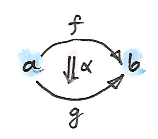

*$`0`$-cells $`a, b`$; $`1`$-cells $`f, g`$; and a $`2`$-cell $`\alpha`$.*

The category of categories $`\mathbf
{Cat}`$ is an immediate example. We have categories as $`0`$-cells, functors as $`1`$-cells, and natural transformations as $`2`$-cells. The laws of a $`\mathbf
{2}`$-category tell us that $`1`$-cells between any two $`0`$-cells form a category (in other words, $`\mathbf
{C}(a, b)`$ is a hom-category rather than a hom-set). This fits nicely with our earlier assertion that functors between any two categories form a functor category.

In particular, $`1`$-cells from any $`0`$-cell back to itself also form a category, the hom-category $`\mathbf
{C}(a, a)`$; but that category has even more structure. Members of $`\mathbf
{C}(a, a)`$ can be viewed as arrows in $`\mathbf
{C}`$ or as objects in $`\mathbf
{C}(a, a)`$. As arrows, they can be composed with each other. But when we look at them as objects, the composition becomes a mapping from a pair of objects to an object. In fact it looks very much like a product — a tensor product to be precise. This tensor product has a unit: the identity $`1`$-cell. It turns out that, in any $`\mathbf
{2}`$-category, a hom-category $`\mathbf
{C}(a, a)`$ is automatically a monoidal category with the tensor product defined as composition of $`1`$-cells. Associativity and unit laws simply fall out from the corresponding category laws.

Let’s see what this means in our canonical example of a $`\mathbf
{2}`$-category $`\mathbf
{Cat}`$. The hom-category $`\mathbf
{Cat}(a, a)`$ is the category of endofunctors on $`a`$. Endofunctor composition plays the role of a tensor product in it. The identity functor is the unit with respect to this product. We’ve seen before that endofunctors form a monoidal category (we used this fact in the definition of a monad), but now we see that this is a more general phenomenon: endo-$`1`$-cells in any $`\mathbf
{2}`$-category form a monoidal category. We’ll come back to it later when we generalize monads.

You might recall that, in a general monoidal category, we did not insist on the monoid laws being satisfied on the nose. It was often enough for the unit laws and the associativity laws to be satisfied up to isomorphism. In a $`\mathbf
{2}`$-category, monoidal laws in $`\mathbf
{C}(a, a)`$ follow from composition laws for $`1`$-cells. These laws are strict, so we will always get a strict monoidal category. It is, however, possible to relax these laws as well. We can say, for instance, that a composition of the identity $`1`$-cell $`\mathbf{id}_{a}`$ with another $`1`$-cell, $`f ::a \to b`$, is isomorphic, rather than equal, to $`f`$. Isomorphism of $`1`$-cells is defined using $`2`$-cells. In other words, there is a $`2`$-cell:
``` math
\rho ::f \circ 
  \mathbf{id}_{a}
 \to f
```
that has an inverse.

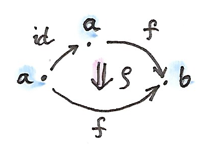

*Identity law in a bicategory holds up to isomorphism (an invertible $`2`$-cell $`\rho`$).*

We can do the same for the left identity and associativity laws. This kind of relaxed $`\mathbf
{2}`$-category is called a bicategory (there are some additional coherency laws, which I will omit here).

As expected, endo-$`1`$-cells in a bicategory form a general monoidal category with non-strict laws.

An interesting example of a bicategory is the category of spans. A span between two objects $`a`$ and $`b`$ is an object $`x`$ and a pair of morphisms:
``` math
\begin{gathered}
  f ::x \to a \\
  g ::x \to b
\end{gathered}
```

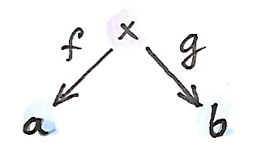

*You might recall that we used spans in the definition of a categorical product. Here, we want to look at spans as $`1`$-cells in a bicategory. The first step is to define a composition of spans. Suppose that we have an adjoining span:*
``` math
\begin{gathered}
  f' ::y \to b \\
  g' ::y \to c
\end{gathered}
```

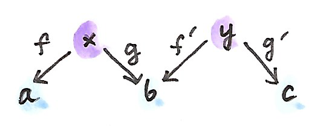

*The composition would be a third span, with some apex $`z`$. The most natural choice for it is the pullback of $`g`$ along $`f'`$. Remember that a pullback is the object $`z`$ together with two morphisms:*
``` math
\begin{aligned}
  h  & ::z \to x \\
  h' & ::z \to y
\end{aligned}
```
such that:
``` math
g \circ h = f' \circ h'
```
which is universal among all such objects.

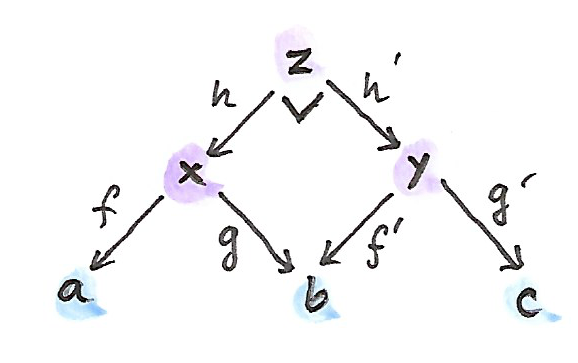

*For now, let’s concentrate on spans over the category of sets. In that case, the pullback is just a set of pairs $`(p, q)`$ from the Cartesian product $`x \times y`$ such that:*
``` math
g\ p = f'\ q
```
A morphism between two spans that share the same endpoints is defined as a morphism $`h`$ between their apices, such that the appropriate triangles commute.

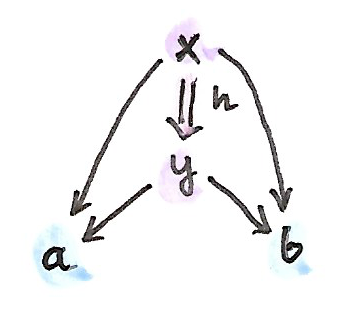

*A $`2`$-cell in $`\mathbf*
{Span}`$.

To summarize, in the bicategory $`\mathbf
{Span}`$: $`0`$-cells are sets, $`1`$-cells are spans, $`2`$-cells are span morphisms. An identity $`1`$-cell is a degenerate span in which all three objects are the same, and the two morphisms are identities.

We’ve seen another example of a bicategory before: the bicategory $`\mathbf
{Prof}`$ of profunctors, where 0-cells are categories, 1-cells are profunctors, and 2-cells are natural transformations. The composition of profunctors was given by a coend.

# Monads

By now you should be pretty familiar with the definition of a monad as a monoid in the category of endofunctors. Let’s revisit this definition with the new understanding that the category of endofunctors is just one small hom-category of endo-$`1`$-cells in the bicategory $`\mathbf
{Cat}`$. We know it’s a monoidal category: the tensor product comes from the composition of endofunctors. A monoid is defined as an object in a monoidal category — here it will be an endofunctor $`T`$ — together with two morphisms. Morphisms between endofunctors are natural transformations. One morphism maps the monoidal unit — the identity endofunctor — to $`T`$:
``` math
\eta ::I \to T
```
The second morphism maps the tensor product of $`T \otimes T`$ to $`T`$. The tensor product is given by endofunctor composition, so we get:
``` math
\mu ::T \circ T \to T
```

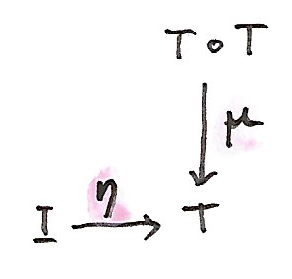

*We recognize these as the two operations defining a monad (they are called `return` and `join` in Haskell), and we know that monoid laws turn to monad laws.*

Now let’s remove all mention of endofunctors from this definition. We start with a bicategory $`\mathbf
{C}`$ and pick a $`0`$-cell $`a`$ in it. As we’ve seen earlier, the hom-category $`\mathbf
{C}(a, a)`$ is a monoidal category. We can therefore define a monoid in $`\mathbf
{C}(a, a)`$ by picking a $`1`$-cell, $`T`$, and two $`2`$-cells:
``` math
\begin{aligned}
  \eta & ::I \to T         \\
  \mu  & ::T \circ T \to T
\end{aligned}
```
satisfying the monoid laws. We call *this* a monad.

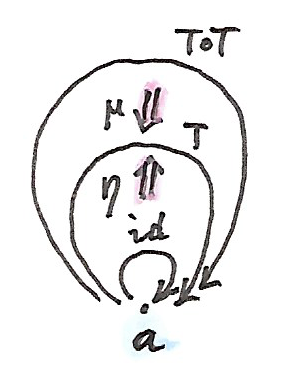

*That’s a much more general definition of a monad using only $`0`$-cells, $`1`$-cells, and $`2`$-cells. It reduces to the usual monad when applied to the bicategory $`\mathbf*
{Cat}`$. But let’s see what happens in other bicategories.

Let’s construct a monad in $`\mathbf
{Span}`$. We pick a $`0`$-cell, which is a set that, for reasons that will become clear soon, I will call $`\mathit{Ob}`$. Next, we pick an endo-$`1`$-cell: a span from $`\mathit{Ob}`$ back to $`\mathit{Ob}`$. It has a set at the apex, which I will call $`\mathit{Arr}`$, equipped with two functions:
``` math
\begin{aligned}
  \mathit{dom} & ::\mathit{Arr} \to \mathit{Ob} \\
  \mathit{cod} & ::\mathit{Arr} \to \mathit{Ob}
\end{aligned}
```

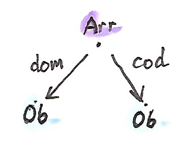

*Let’s call the elements of the set $`\mathit{Arr}`$ “arrows.” If I also tell you to call the elements of $`\mathit{Ob}`$ “objects,” you might get a hint where this is leading to. The two functions $`\mathit{dom}`$ and $`\mathit{cod}`$ assign the domain and the codomain to an “arrow.”*

To make our span into a monad, we need two $`2`$-cells, $`\eta`$ and $`\mu`$. The monoidal unit, in this case, is the trivial span from $`\mathit{Ob}`$ to $`\mathit{Ob}`$ with the apex at $`\mathit{Ob}`$ and two identity functions. The $`2`$-cell $`\eta`$ is a function between the apices $`\mathit{Ob}`$ and $`\mathit{Arr}`$. In other words, $`\eta`$ assigns an “arrow” to every “object.” A $`2`$-cell in $`\mathbf
{Span}`$ must satisfy commutation conditions — in this case:
``` math
\begin{aligned}
  \mathit{dom} & \circ \eta = \mathbf{id}\\
  \mathit{cod} & \circ \eta = \mathbf{id}
\end{aligned}
```

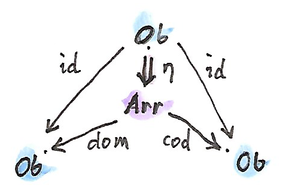

*In components, this becomes:*
``` math
\mathit{dom}\ (\eta\ \mathit{ob}) = \mathit{ob} = \mathit{cod}\ (\eta\ \mathit{ob})
```
where $`\mathit{ob}`$ is an “object” in $`\mathit{Ob}`$. In other words, $`\eta`$ assigns to every “object” an “arrow” whose domain and codomain are that “object.” We’ll call this special “arrow” the “identity arrow.”

The second $`2`$-cell $`\mu`$ acts on the composition of the span $`\mathit{Arr}`$ with itself. The composition is defined as a pullback, so its elements are pairs of elements from $`\mathit{Arr}`$ — pairs of “arrows” $`(a_1, a_2)`$. The pullback condition is:
``` math
\mathit{cod}\ a_1 = \mathit{dom}\ a_2
```
We say that $`a_1`$ and $`a_2`$ are “composable,” because the domain of one is the codomain of the other.

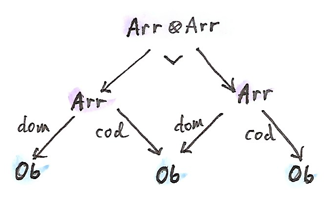

*The $`2`$-cell $`\mu`$ is a function that maps a pair of composable “arrows” $`(a_1, a_2)`$ to a single “arrow” $`a_3`$ from $`\mathit{Arr}`$. In other words $`\mu`$ defines composition of “arrows”.*

It’s easy to check that monad laws correspond to identity and associativity laws for arrows. We have just defined a category (a small category, mind you, in which objects and arrows form sets).

So, all told, a category is just a monad in the bicategory of spans.

What is amazing about this result is that it puts categories on the same footing as other algebraic structures like monads and monoids. There is nothing special about being a category. It’s just two sets and four functions. In fact we don’t even need a separate set for objects, because objects can be identified with identity arrows (they are in one-to-one correspondence). So it’s really just a set and a few functions. Considering the pivotal role that category theory plays in all of mathematics, this is a very humbling realization.

# Challenges

1.  Derive unit and associativity laws for the tensor product defined as composition of endo-$`1`$-cells in a bicategory.

2.  Check that monad laws for a monad in $`\mathbf
    {Span}`$ correspond to identity and associativity laws in the resulting category.

3.  Show that a monad in $`\mathbf
    {Prof}`$ is an identity-on-objects functor.

4.  What’s a monad algebra for a monad in $`\mathbf
    {Span}`$?

# Bibliography

1.  [Paweł Sobociński’s blog](https://graphicallinearalgebra.net/2017/04/16/a-monoid-is-a-category-a-category-is-a-monad-a-monad-is-a-monoid/).
