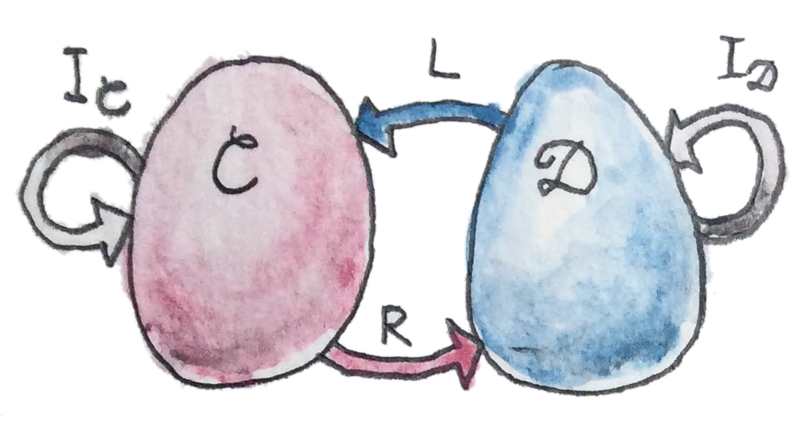
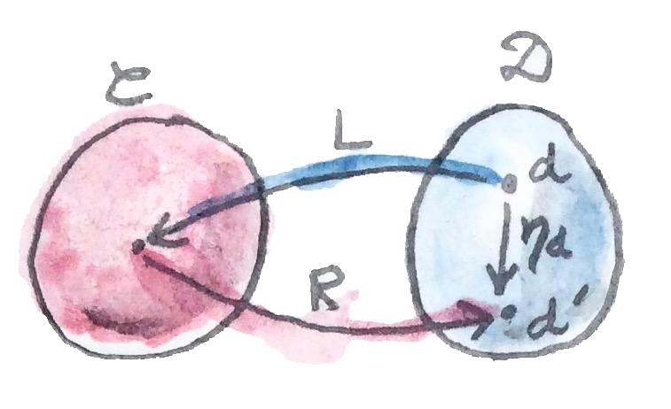
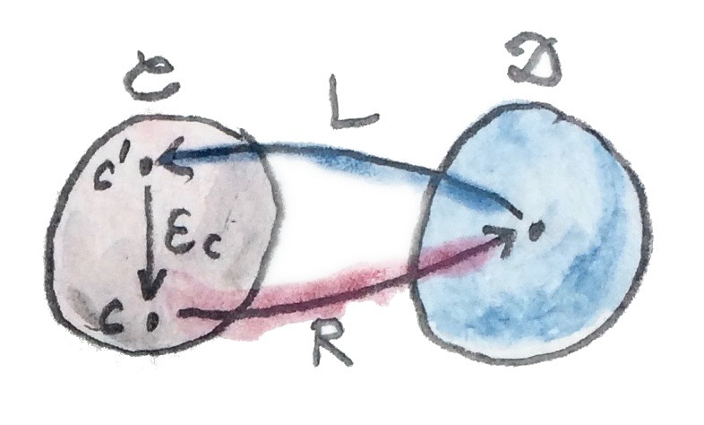
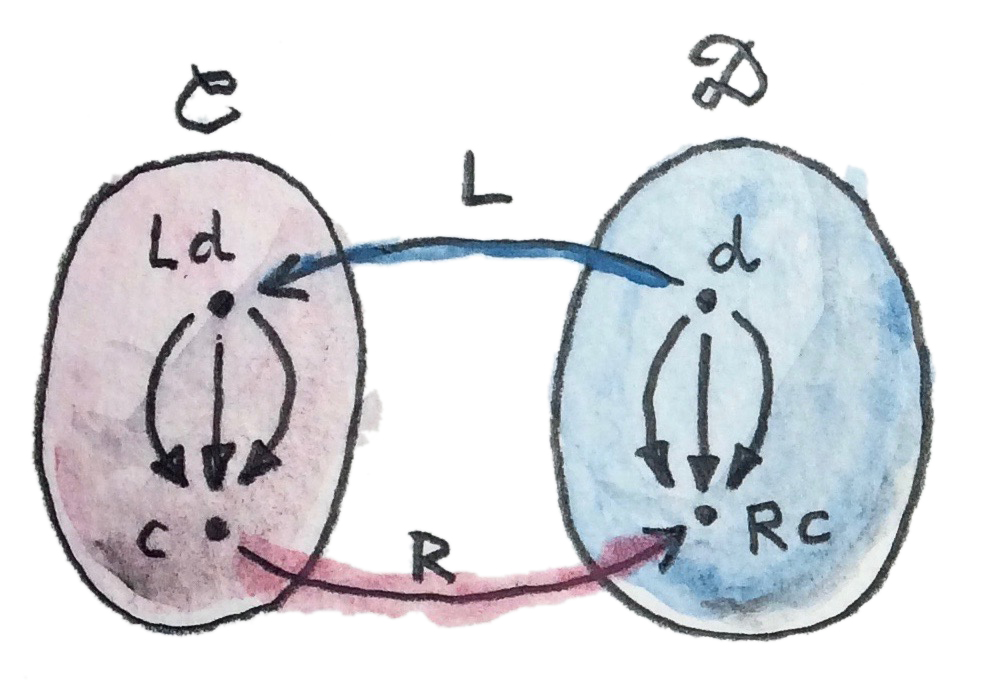
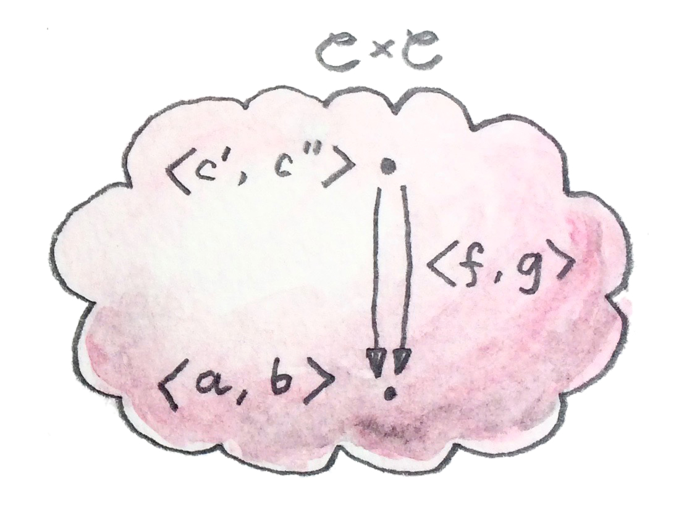
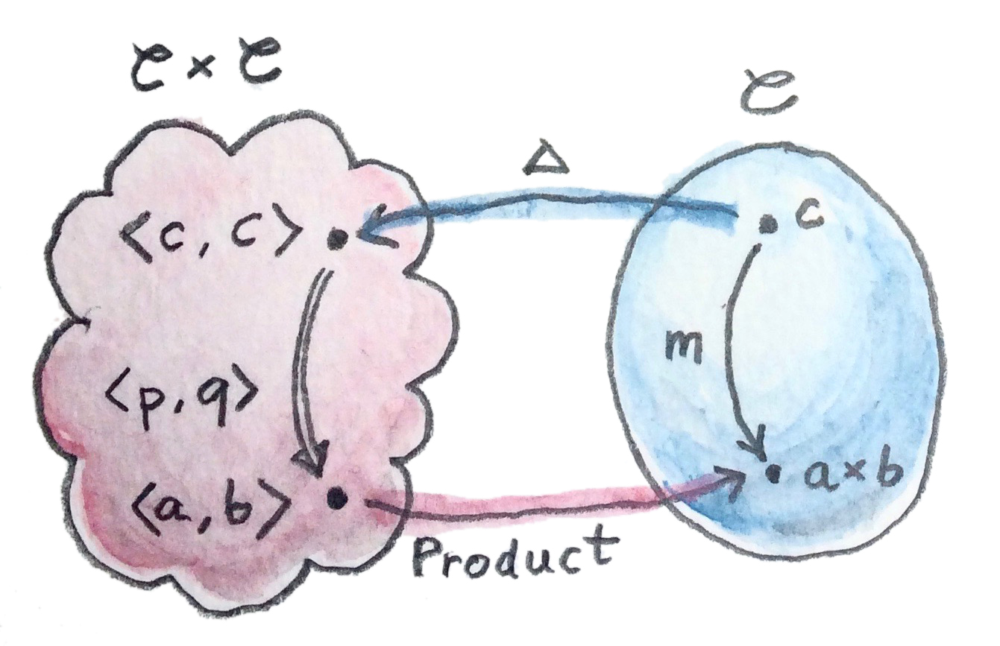
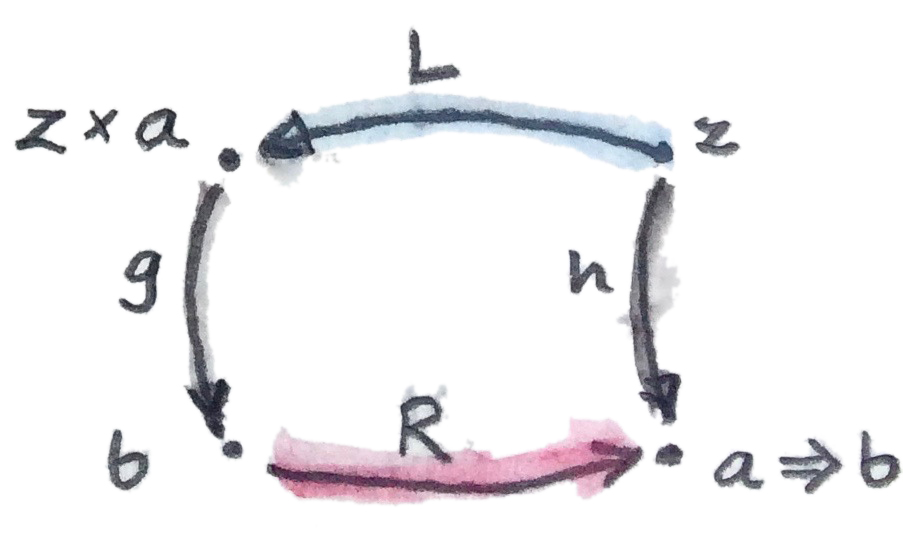

In mathematics we have various ways of saying that one thing is like another. The strictest is equality. Two things are equal if there is no way to distinguish one from another. One can be substituted for the other in every imaginable context. For instance, did you notice that we used *equality* of morphisms every time we talked about commuting diagrams? That’s because morphisms form a set (hom-set) and set elements can be compared for equality.

But equality is often too strong. There are many examples of things being the same for all intents and purposes, without actually being equal. For instance, the pair type `(Bool, Char)` is not strictly equal to `(Char, Bool)`, but we understand that they contain the same information. This concept is best captured by an *isomorphism* between two types — a morphism that’s invertible. Since it’s a morphism, it preserves the structure; and being “iso” means that it’s part of a round trip that lands you in the same spot, no matter on which side you start. In the case of pairs, this isomorphism is called `swap`:

``` haskell
swap :: (a,b) -> (b,a)
swap (a,b) = (b,a)
```

`swap` happens to be its own inverse.

# Adjunction and Unit/Counit Pair

When we talk about categories being isomorphic, we express this in terms of mappings between categories, a.k.a. functors. We would like to be able to say that two categories $`\mathbf
{C}`$ and $`\mathbf
{D}`$ are isomorphic if there exists a functor $`R`$ (“right”) from $`\mathbf
{C}`$ to $`\mathbf
{D}`$, which is invertible. In other words, there exists another functor $`L`$ (“left”) from $`\mathbf
{D}`$ back to $`\mathbf
{C}`$ which, when composed with $`R`$, is equal to the identity functor $`I`$. There are two possible compositions, $`R \circ L`$ and $`L \circ R`$; and two possible identity functors: one in $`\mathbf
{C}`$ and another in $`\mathbf
{D}`$.



*But here’s the tricky part: What does it mean for two functors to be *equal*? What do we mean by this equality:*
``` math
R \circ L = I_{
  \mathbf
{D}}
```
or this one:
``` math
L \circ R = I_{
  \mathbf
{C}}
```
It would be reasonable to define functor equality in terms of equality of objects. Two functors, when acting on equal objects, should produce equal objects. But we don’t, in general, have the notion of object equality in an arbitrary category. It’s just not part of the definition. (Going deeper into this rabbit hole of “what equality really is,” we would end up in Homotopy Type Theory.)

You might argue that functors *are* morphisms in the category of categories, so they should be equality-comparable. And indeed, as long as we are talking about small categories, where objects form a set, we can indeed use the equality of elements of a set to equality-compare objects.

But, remember, $`\mathbf
{Cat}`$ is really a $`\mathbf
{2}`$-category. Hom-sets in a $`\mathbf
{2}`$-category have additional structure — there are $`2`$-morphisms acting between $`1`$-morphisms. In $`\mathbf
{Cat}`$, $`1`$-morphisms are functors, and $`2`$-morphisms are natural transformations. So it’s more natural (can’t avoid this pun!) to consider natural isomorphisms as substitutes for equality when talking about functors.

So, instead of isomorphism of categories, it makes sense to consider a more general notion of *equivalence*. Two categories $`\mathbf
{C}`$ and $`\mathbf
{D}`$ are *equivalent* if we can find two functors going back and forth between them, whose composition (either way) is *naturally isomorphic* to the identity functor. In other words, there is a two-way natural transformation between the composition $`R \circ L`$ and the identity functor $`I_{
  \mathbf
{D}}`$, and another between $`L \circ R`$ and the identity functor $`I_{
  \mathbf
{C}}`$.

Adjunction is even weaker than equivalence, because it doesn’t require that the composition of the two functors be *isomorphic* to the identity functor. Instead it stipulates the existence of a *one way* natural transformation from $`I_{
  \mathbf
{D}}`$ to $`R \circ L`$, and another from $`L \circ R`$ to $`I_{
  \mathbf
{C}}`$. Here are the signatures of these two natural transformations:
``` math
\begin{gathered}
  \eta ::I_{
  \mathbf
{D}} \to R \circ L \\
  \varepsilon ::L \circ R \to I_{
  \mathbf
{C}}
\end{gathered}
```
$`\eta`$ is called the unit, and $`\varepsilon`$ the counit of the adjunction.

Notice the asymmetry between these two definitions. In general, we don’t have the two remaining mappings:
``` math
\begin{gathered}
  R \circ L \to I_{
  \mathbf
{D}} \quad\quad\text{not necessarily} \\
  I_{
  \mathbf
{C}} \to L \circ R \quad\quad\text{not necessarily}
\end{gathered}
```
Because of this asymmetry, the functor $`L`$ is called the *left adjoint* to the functor $`R`$, while the functor $`R`$ is the right adjoint to $`L`$. (Of course, left and right make sense only if you draw your diagrams one particular way.)

The compact notation for the adjunction is:
``` math
L \dashv R
```
To better understand the adjunction, let’s analyze the unit and the counit in more detail.



*Let’s start with the unit. It’s a natural transformation, so it’s a family of morphisms. Given an object $`d`$ in $`\mathbf*
{D}`$, the component of $`\eta`$ is a morphism between $`I d`$, which is equal to $`d`$, and $`(R \circ L) d`$; which, in the picture, is called $`d'`$:
``` math
\eta_d ::d \to (R \circ L) d
```
Notice that the composition $`R \circ L`$ is an endofunctor in $`\mathbf
{D}`$.

This equation tells us that we can pick any object $`d`$ in $`\mathbf
{D}`$ as our starting point, and use the round trip functor $`R \circ L`$ to pick our target object $`d'`$. Then we shoot an arrow — the morphism $`\eta_d`$ — to our target.



*By the same token, the component of the counit $`\varepsilon`$ can be described as:*
``` math
\varepsilon_{c} ::(L \circ R) c \to c
```
It tells us that we can pick any object $`c`$ in $`\mathbf
{C}`$ as our target, and use the round trip functor $`L \circ R`$ to pick the source $`c' = (L \circ R) c`$. Then we shoot the arrow — the morphism $`\varepsilon_{c}`$ — from the source to the target.

Another way of looking at unit and counit is that unit lets us *introduce* the composition $`R \circ L`$ anywhere we could insert an identity functor on $`\mathbf
{D}`$; and counit lets us *eliminate* the composition $`L \circ R`$, replacing it with the identity on $`\mathbf
{C}`$. That leads to some “obvious” consistency conditions, which make sure that introduction followed by elimination doesn’t change anything:
``` math
\begin{gathered}
  L = L \circ I_{
  \mathbf
{D}} \to L \circ R \circ L \to I_{
  \mathbf
{C}} \circ L = L \\
  R = I_{
  \mathbf
{D}} \circ R \to R \circ L \circ R \to R \circ I_{
  \mathbf
{C}} = R
\end{gathered}
```
These are called triangular identities because they make the following diagrams commute:

These are diagrams in the functor category: the arrows are natural transformations, and their composition is the horizontal composition of natural transformations. In components, these identities become:
``` math
\begin{gathered}
  \varepsilon_{L d} \circ L \eta_d = \mathbf{id}_{L d} \\
  R \varepsilon_{c} \circ \eta_{R c} = \mathbf{id}_{R c}
\end{gathered}
```
We often see unit and counit in Haskell under different names. Unit is known as `return` (or `pure`, in the definition of `Applicative`):

``` haskell
return :: d -> m d
```

and counit as `extract`:

``` haskell
extract :: w c -> c
```

Here, `m` is the (endo-) functor corresponding to $`R \circ L`$, and `w` is the (endo-) functor corresponding to $`L \circ R`$. As we’ll see later, they are part of the definition of a monad and a comonad, respectively.

If you think of an endofunctor as a container, the unit (or `return`) is a polymorphic function that creates a default box around a value of arbitrary type. The counit (or `extract`) does the reverse: it retrieves or produces a single value from a container.

We’ll see later that every pair of adjoint functors defines a monad and a comonad. Conversely, every monad or comonad may be factorized into a pair of adjoint functors — this factorization is not unique, though.

In Haskell, we use monads a lot, but only rarely factorize them into pairs of adjoint functors, primarily because those functors would normally take us out of $`\mathbf{Hask}`$.

We can however define adjunctions of *endofunctors* in Haskell. Here’s part of the definition taken from `Data.Functor.Adjunction`:

``` haskell
class (Functor f, Representable u) =>
      Adjunction f u | f -> u, u -> f where
    unit :: a -> u (f a)
    counit :: f (u a) -> a
```

This definition requires some explanation. First of all, it describes a multi-parameter type class — the two parameters being `f` and `u`. It establishes a relation called `Adjunction` between these two type constructors.

Additional conditions, after the vertical bar, specify functional dependencies. For instance, `f -> u` means that `u` is determined by `f` (the relation between `f` and `u` is a function, here on type constructors). Conversely, `u -> f` means that, if we know `u`, then `f` is uniquely determined.

I’ll explain in a moment why, in Haskell, we can impose the condition that the right adjoint `u` be a *representable* functor.

# Adjunctions and Hom-Sets

There is an equivalent definition of the adjunction in terms of natural isomorphisms of hom-sets. This definition ties nicely with universal constructions we’ve been studying so far. Every time you hear the statement that there is some unique morphism, which factorizes some construction, you should think of it as a mapping of some set to a hom-set. That’s the meaning of “picking a unique morphism.”

Furthermore, factorization can be often described in terms of natural transformations. Factorization involves commuting diagrams — some morphism being equal to a composition of two morphisms (factors). A natural transformation maps morphisms to commuting diagrams. So, in a universal construction, we go from a morphism to a commuting diagram, and then to a unique morphism. We end up with a mapping from morphism to morphism, or from one hom-set to another (usually in different categories). If this mapping is invertible, and if it can be naturally extended across all hom-sets, we have an adjunction.

The main difference between universal constructions and adjunctions is that the latter are defined globally — for all hom-sets. For instance, using a universal construction you can define a product of two select objects, even if it doesn’t exist for any other pair of objects in that category. As we’ll see soon, if the product of *any pair* of objects exists in a category, it can be also defined through an adjunction.



*Here’s the alternative definition of the adjunction using hom-sets. As before, we have two functors $`L ::*
  \mathbf
{D} \to 
  \mathbf
{C}`$ and $`R ::
  \mathbf
{C} \to 
  \mathbf
{D}`$. We pick two arbitrary objects: the source object $`d`$ in $`\mathbf
{D}`$, and the target object $`c`$ in $`\mathbf
{C}`$. We can map the source object $`d`$ to $`\mathbf
{C}`$ using $`L`$. Now we have two objects in $`\mathbf
{C}`$, $`L d`$ and $`c`$. They define a hom-set:
``` math
\mathbf
{C}(L d, c)
```
Similarly, we can map the target object $`c`$ using $`R`$. Now we have two objects in $`\mathbf
{D}`$, $`d`$ and $`R c`$. They, too, define a hom set:
``` math
\mathbf
{D}(d, R c)
```
We say that $`L`$ is left adjoint to $`R`$ iff there is an isomorphism of hom sets:
``` math
\mathbf
{C}(L d, c) \cong 
  \mathbf
{D}(d, R c)
```
that is natural both in $`d`$ and $`c`$. Naturality means that the source $`d`$ can be varied smoothly across $`\mathbf
{D}`$; and the target $`c`$, across $`\mathbf
{C}`$. More precisely, we have a natural transformation $`\varphi`$ between the following two (covariant) functors from $`\mathbf
{C}`$ to $`\mathbf
{Set}`$. Here’s the action of these functors on objects:
``` math
\begin{gathered}
  c \to 
  \mathbf
{C}(L d, c) \\
  c \to 
  \mathbf
{D}(d, R c)
\end{gathered}
```
The other natural transformation, $`\psi`$, acts between the following (contravariant) functors:
``` math
\begin{gathered}
  d \to 
  \mathbf
{C}(L d, c) \\
  d \to 
  \mathbf
{D}(d, R c)
\end{gathered}
```
Both natural transformations must be invertible.

It’s easy to show that the two definitions of the adjunction are equivalent. For instance, let’s derive the unit transformation starting from the isomorphism of hom-sets:
``` math
\mathbf
{C}(L d, c) \cong 
  \mathbf
{D}(d, R c)
```
Since this isomorphism works for any object $`c`$, it must also work for $`c = L d`$:
``` math
\mathbf
{C}(L d, L d) \cong 
  \mathbf
{D}(d, (R \circ L) d)
```
We know that the left hand side must contain at least one morphism, the identity. The natural transformation will map this morphism to an element of $`\mathbf
{D}(d, (R \circ L) d)`$ or, inserting the identity functor $`I`$, a morphism in:
``` math
\mathbf
{D}(I d, (R \circ L) d)
```
We get a family of morphisms parameterized by $`d`$. They form a natural transformation between the functor $`I`$ and the functor $`R \circ L`$ (the naturality condition is easy to verify). This is exactly our unit, $`\eta`$.

Conversely, starting from the existence of the unit and counit, we can define the transformations between hom-sets. For instance, let’s pick an arbitrary morphism $`f`$ in the hom-set $`\mathbf
{C}(L d, c)`$. We want to define a $`\varphi`$ that, acting on $`f`$, produces a morphism in $`\mathbf
{D}(d, R c)`$.

There isn’t really much choice. One thing we can try is to lift $`f`$ using $`R`$. That will produce a morphism $`R f`$ from $`R (L d)`$ to $`R c`$ — a morphism that’s an element of $`\mathbf
{D}((R \circ L) d, R c)`$.

What we need for a component of $`\varphi`$, is a morphism from $`d`$ to $`R c`$. That’s not a problem, since we can use a component of $`\eta_d`$ to get from $`d`$ to $`(R \circ L) d`$. We get:
``` math
\varphi_f = R f \circ \eta_d
```
The other direction is analogous, and so is the derivation of $`\psi`$.

Going back to the Haskell definition of `Adjunction`, the natural transformations $`\varphi`$ and $`\psi`$ are replaced by polymorphic (in `a` and `b`) functions `leftAdjunct` and `rightAdjunct`, respectively. The functors $`L`$ and $`R`$ are called `f` and `u`:

``` haskell
class (Functor f, Representable u) => 
  Adjunction f u | f -> u, u -> f where
    leftAdjunct  :: (f a -> b) -> (a -> u b)
    rightAdjunct :: (a -> u b) -> (f a -> b)
```

The equivalence between the `unit`/`counit` formulation and the `leftAdjunct`/`rightAdjunct` formulation is witnessed by these mappings:

``` haskell
unit           = leftAdjunct id
counit         = rightAdjunct id
leftAdjunct f  = fmap f . unit
rightAdjunct f = counit . fmap f
```

It’s very instructive to follow the translation from the categorical description of the adjunction to Haskell code. I highly encourage this as an exercise.

We are now ready to explain why, in Haskell, the right adjoint is automatically a representable functor. The reason for this is that, to the first approximation, we can treat the category of Haskell types as the category of sets.

When the right category $`\mathbf
{D}`$ is $`\mathbf
{Set}`$, the right adjoint $`R`$ is a functor from $`\mathbf
{C}`$ to $`\mathbf
{Set}`$. Such a functor is representable if we can find an object $`\mathit{rep}`$ in $`\mathbf
{C}`$ such that the hom-functor $`\mathbf
{C}(\mathit{rep}, \_)`$ is naturally isomorphic to $`R`$. It turns out that, if $`R`$ is the right adjoint of some functor $`L`$ from $`\mathbf
{Set}`$ to $`\mathbf
{C}`$, such an object always exists — it’s the image of the singleton set $`()`$ under $`L`$:
``` math
\mathit{rep} = L ()
```
Indeed, the adjunction tells us that the following two hom-sets are naturally isomorphic:
``` math
\mathbf
{C}(L (), c) \cong 
  \mathbf
{Set}((), R c)
```
For a given $`c`$, the right hand side is the set of functions from the singleton set $`()`$ to $`R c`$. We’ve seen earlier that each such function picks one element from the set $`R c`$. The set of such functions is isomorphic to the set $`R c`$. So we have:
``` math
\mathbf
{C}(L (), -) \cong R
```
which shows that $`R`$ is indeed representable.

# Product from Adjunction

We have previously introduced several concepts using universal constructions. Many of those concepts, when defined globally, are easier to express using adjunctions. The simplest non-trivial example is that of the product. The gist of the universal construction of the product is the ability to factorize any product-like candidate through the universal product.

More precisely, the product of two objects $`a`$ and $`b`$ is the object $`(a\times{}b)`$ (or `(a, b)` in the Haskell notation) equipped with two morphisms $`\mathit{fst}`$ and $`\mathit{snd}`$ such that, for any other candidate $`c`$ equipped with two morphisms $`p ::c \to a`$ and $`q ::c \to b`$, there exists a unique morphism $`m ::c \to (a, b)`$ that factorizes $`p`$ and $`q`$ through $`\mathit{fst}`$ and $`\mathit{snd}`$.

As we’ve seen earlier, in Haskell, we can implement a `factorizer` that generates this morphism from the two projections:

``` haskell
factorizer :: (c -> a) -> (c -> b) -> (c -> (a, b))
factorizer p q = \x -> (p x, q x)
```

It’s easy to verify that the factorization conditions hold:

``` haskell
fst . factorizer p q = p
snd . factorizer p q = q
```

We have a mapping that takes a pair of morphisms `p` and `q` and produces another morphism `m = factorizer p q`.

How can we translate this into a mapping between two hom-sets that we need to define an adjunction? The trick is to go outside of $`\mathbf{Hask}`$ and treat the pair of morphisms as a single morphism in the product category.

Let me remind you what a product category is. Take two arbitrary categories $`\mathbf
{C}`$ and $`\mathbf
{D}`$. The objects in the product category $`\mathbf
{C}\times{}
  \mathbf
{D}`$ are pairs of objects, one from $`\mathbf
{C}`$ and one from $`\mathbf
{D}`$. The morphisms are pairs of morphisms, one from $`\mathbf
{C}`$ and one from $`\mathbf
{D}`$.

To define a product in some category $`\mathbf
{C}`$, we should start with the product category $`\mathbf
{C}\times{}
  \mathbf
{C}`$. Pairs of morphism from $`\mathbf
{C}`$ are single morphisms in the product category $`\mathbf
{C}\times{}
  \mathbf
{C}`$.



*It might be a little confusing at first that we are using a product category to define a product. These are, however, very different products. We don’t need a universal construction to define a product category. All we need is the notion of a pair of objects and a pair of morphisms.*

However, a pair of objects from $`\mathbf
{C}`$ is *not* an object in $`\mathbf
{C}`$. It’s an object in a different category, $`\mathbf
{C}\times{}
  \mathbf
{C}`$. We can write the pair formally as $`\langle a, b \rangle`$, where $`a`$ and $`b`$ are objects of $`\mathbf
{C}`$. The universal construction, on the other hand, is necessary in order to define the object $`a\times{}b`$ (or `(a, b)` in Haskell), which is an object in *the same* category $`\mathbf
{C}`$. This object is supposed to represent the pair $`\langle a, b \rangle`$ in a way specified by the universal construction. It doesn’t always exist and, even if it exists for some, might not exist for other pairs of objects in $`\mathbf
{C}`$.

Let’s now look at the `factorizer` as a mapping of hom-sets. The first hom-set is in the product category $`\mathbf
{C}\times{}
  \mathbf
{C}`$, and the second is in $`\mathbf
{C}`$. A general morphism in $`\mathbf
{C}\times{}
  \mathbf
{C}`$ would be a pair of morphisms $`\langle f, g \rangle`$:
``` math
\begin{gathered}
  f ::c' \to a \\
  g ::c'' \to b
\end{gathered}
```
with $`c''`$ potentially different from $`c'`$. But to define a product, we are interested in a special morphism in $`\mathbf
{C}\times{}
  \mathbf
{C}`$, the pair $`p`$ and $`q`$ that share the same source object $`c`$. That’s okay: In the definition of an adjunction, the source of the left hom-set is not an arbitrary object — it’s the result of the left functor $`L`$ acting on some object from the right category. The functor that fits the bill is easy to guess — it’s the diagonal functor $`\Delta`$ from $`\mathbf
{C}`$ to $`\mathbf
{C}\times{}
  \mathbf
{C}`$, whose action on objects is:
``` math
\Delta c = \langle c, c \rangle
```
The left-hand side hom-set in our adjunction should thus be:
``` math
(
  \mathbf
{C}\times{}
  \mathbf
{C})(\Delta c, \langle a, b \rangle)
```
It’s a hom-set in the product category. Its elements are pairs of morphisms that we recognize as the arguments to our `factorizer`:
``` math
(c \to a) \to (c \to b) \ldots{}
```
The right-hand side hom-set lives in $`\mathbf
{C}`$, and it goes between the source object $`c`$ and the result of some functor $`R`$ acting on the target object in $`\mathbf
{C}\times{}
  \mathbf
{C}`$. That’s the functor that maps the pair $`\langle a, b \rangle`$ to our product object, $`a\times{}b`$. We recognize this element of the hom-set as the *result* of the `factorizer`:
``` math
\ldots{} \to (c \to (a, b))
```



*We still don’t have a full adjunction. For that we first need our `factorizer` to be invertible — we are building an *isomorphism* between hom-sets. The inverse of the `factorizer` should start from a morphism $`m`$ — a morphism from some object $`c`$ to the product object $`a\times{}b`$. In other words, $`m`$ should be an element of:*
``` math
\mathbf
{C}(c, a\times{}b)
```
The inverse factorizer should map $`m`$ to a morphism $`\langle p, q \rangle`$ in $`\mathbf
{C}\times{}
  \mathbf
{C}`$ that goes from $`\langle c, c \rangle`$ to $`\langle a, b \rangle`$; in other words, a morphism that’s an element of:
``` math
(
  \mathbf
{C}\times{}
  \mathbf
{C})(\Delta\ c, \langle a, b \rangle)
```
If that mapping exists, we conclude that there exists the right adjoint to the diagonal functor. That functor defines a product.

In Haskell, we can always construct the inverse of the `factorizer` by composing `m` with, respectively, `fst` and `snd`.

``` haskell
p = fst . m
q = snd . m
```

To complete the proof of the equivalence of the two ways of defining a product we also need to show that the mapping between hom-sets is natural in $`a`$, $`b`$, and $`c`$. I will leave this as an exercise for the dedicated reader.

To summarize what we have done: A categorical product may be defined globally as the *right adjoint* of the diagonal functor:
``` math
(
  \mathbf
{C}\times{}
  \mathbf
{C})(\Delta c, \langle a, b \rangle) \cong 
  \mathbf
{C}(c, a\times{}b)
```
Here, $`a\times{}b`$ is the result of the action of our right adjoint functor $`\mathit{Product}`$ on the pair $`\langle a, b \rangle`$. Notice that any functor from $`\mathbf
{C}\times{}
  \mathbf
{C}`$ is a bifunctor, so $`\mathit{Product}`$ is a bifunctor. In Haskell, the $`\mathit{Product}`$ bifunctor is written simply as `(,)`. You can apply it to two types and get their product type, for instance:

``` haskell
(,) Int Bool ~ (Int, Bool)
```

# Exponential from Adjunction

The exponential $`b^a`$, or the function object $`a \Rightarrow b`$, can be defined using a universal construction. This construction, if it exists for all pairs of objects, can be seen as an adjunction. Again, the trick is to concentrate on the statement:

> For any other object $`z`$ with a morphism $`g ::z\times{}a \to b`$ there is a unique morphism $`h ::z \to (a \Rightarrow b)`$

This statement establishes a mapping between hom-sets.

In this case, we are dealing with objects in the same category, so the two adjoint functors are endofunctors. The left (endo-)functor $`L`$, when acting on object $`z`$, produces $`z\times{}a`$. It’s a functor that corresponds to taking a product with some fixed $`a`$.

The right (endo-)functor $`R`$, when acting on $`b`$ produces the function object $`a \Rightarrow b`$ (or $`b^a`$). Again, $`a`$ is fixed. The adjunction between these two functors is often written as:
``` math
-\times{}a \dashv (-)^a
```
The mapping of hom-sets that underlies this adjunction is best seen by redrawing the diagram that we used in the universal construction.



*Notice that the $`\mathit{eval}`$ morphism[^1] is nothing else but the counit of this adjunction:*
``` math
(a \Rightarrow b)\times{}a \to b
```
where:
``` math
(a \Rightarrow b)\times{}a = (L \circ R) b
```
I have previously mentioned that a universal construction defines a unique object, up to isomorphism. That’s why we have “the” product and “the” exponential. This property translates to adjunctions as well: if a functor has an adjoint, this adjoint is unique up to isomorphism.

# Challenges

1.  Derive the naturality square for $`\psi`$, the transformation between the two (contravariant) functors:
    ``` math
    \begin{gathered}
              a \to 
      \mathbf
    {C}(L a, b) \\
              a \to 
      \mathbf
    {D}(a, R b)
            
    \end{gathered}
    ```

2.  Derive the counit $`\varepsilon`$ starting from the hom-sets isomorphism in the second definition of the adjunction.

3.  Complete the proof of equivalence of the two definitions of the adjunction.

4.  Show that the coproduct can be defined by an adjunction. Start with the definition of the factorizer for a coproduct.

5.  Show that the coproduct is the left adjoint of the diagonal functor.

6.  Define the adjunction between a product and a function object in Haskell.

[^1]: See ch.9 on universal construction.
