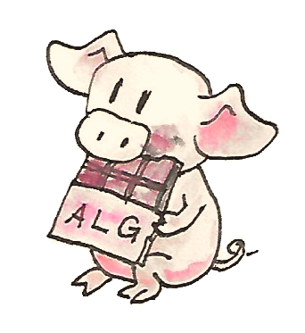

If we interpret endofunctors as ways of defining expressions, algebras let us evaluate them and monads let us form and manipulate them. By combining algebras with monads we not only gain a lot of functionality but we can also answer a few interesting questions.

One such question concerns the relation between monads and adjunctions. As we’ve seen, every adjunction defines a monad (and a comonad). The question is: Can every monad (comonad) be derived from an adjunction? The answer is positive. There is a whole family of adjunctions that generate a given monad. I’ll show you two such adjunctions.



*Let’s review the definitions. A monad is an endofunctor $`m`$ equipped with two natural transformations that satisfy some coherence conditions. The components of these transformations at $`a`$ are:*
``` math
\begin{aligned}
  \eta_a & ::a \to m\ a         \\
  \mu_a  & ::m\ (m\ a) \to m\ a
\end{aligned}
```
An algebra for the same endofunctor is a selection of a particular object — the carrier $`a`$ — together with the morphism:
``` math
\mathit{alg} ::m\ a \to a
```
The first thing to notice is that the algebra goes in the opposite direction to $`\eta_a`$. The intuition is that $`\eta_a`$ creates a trivial expression from a value of type $`a`$. The first coherence condition that makes the algebra compatible with the monad ensures that evaluating this expression using the algebra whose carrier is $`a`$ gives us back the original value:
``` math
\mathit{alg} \circ \eta_a = \mathbf{id}_a
```
The second condition arises from the fact that there are two ways of evaluating the doubly nested expression $`m\ (m\ a)`$. We can first apply $`\mu_a`$ to flatten the expression, and then use the evaluator of the algebra; or we can apply the lifted evaluator to evaluate the inner expressions, and then apply the evaluator to the result. We’d like the two strategies to be equivalent:
``` math
\mathit{alg} \circ \mu_a = \mathit{alg} \circ m\ \mathit{alg}
```
Here, $`m\ \mathit{alg}`$ is the morphism resulting from lifting $`\mathit{alg}`$ using the functor $`m`$. The following commuting diagrams describe the two conditions (I replaced $`m`$ with $`T`$ in anticipation of what follows):

We can also express these conditions in Haskell:

``` haskell
alg . return = id
alg . join = alg . fmap alg
```

Let’s look at a small example. An algebra for a list endofunctor consists of some type `a` and a function that produces an `a` from a list of `a`. Suppose that we can express this function using `foldr` by choosing both the element type and the accumulator type to be equal to `a`:

``` haskell
foldr :: (a -> a -> a) -> a -> [a] -> a
```

This particular algebra is specified by a two-argument function, let’s call it `f`, and a value `z`. The list functor happens to also be a monad, with `return` turning a value into a singleton list. The composition of the algebra, here `foldr f z`, after `return` takes `x` to:

``` haskell
foldr f z [x] = x `f` z
```

where the action of `f` is written in the infix notation. The algebra is compatible with the monad if the following coherence condition is satisfied for every `x`:

``` haskell
x `f` z = x
```

If we look at `f` as a binary operator, this condition tells us that `z` is the right unit.

The second coherence condition operates on a list of lists. The action of `join` concatenates the individual lists. We can then fold the resulting list. On the other hand, we can first fold the individual lists, and then fold the resulting list. Again, if we interpret `f` as a binary operator, this condition tells us that this binary operation is associative. These conditions are certainly fulfilled when `(a, f, z)` is a monoid.

# $`T`$-algebras

Since mathematicians prefer to call their monads $`T`$, they call algebras compatible with them $`T`$-algebras. $`T`$-algebras for a given monad $`T`$ in a category $`\mathbf
{C}`$ form a category called the Eilenberg-Moore category, often denoted by $`\mathbf
{C}^T`$. Morphisms in that category are homomorphisms of algebras. These are the same homomorphisms we’ve seen defined for $`F`$-algebras.

A $`T`$-algebra is a pair consisting of a carrier object and an evaluator, $`(a, f)`$. There is an obvious forgetful functor $`U^T`$ from $`\mathbf
{C}^T`$ to $`\mathbf
{C}`$, which maps $`(a, f)`$ to $`a`$. It also maps a homomorphism of $`T`$-algebras to a corresponding morphism between carrier objects in $`\mathbf
{C}`$. You may remember from our discussion of adjunctions that the left adjoint to a forgetful functor is called a free functor.

The left adjoint to $`U^T`$ is called $`F^T`$. It maps an object $`a`$ in $`\mathbf
{C}`$ to a free algebra in $`\mathbf
{C}^T`$. The carrier of this free algebra is $`T a`$. Its evaluator is a morphism from $`T (T a)`$ back to $`T a`$. Since $`T`$ is a monad, we can use the monadic $`\mu_a`$ (`join` in Haskell) as the evaluator.

We still have to show that this is a $`T`$-algebra. For that, two coherence conditions must be satisfied:
``` math
\begin{aligned}
  \mathit{alg} & \circ \eta_{Ta} = \mathbf{id}_{Ta}     \\
  \mathit{alg} & \circ \mu_a = \mathit{alg} \circ T\ \mathit{alg}
\end{aligned}
```
But these are just monadic laws, if you plug in $`\mu`$ for the algebra.

As you may recall, every adjunction defines a monad. It turns out that the adjunction between $`F^T`$ and $`U^T`$ defines the very monad $`T`$ that was used in the construction of the Eilenberg-Moore category. Since we can perform this construction for every monad, we conclude that every monad can be generated from an adjunction. Later I’ll show you that there is another adjunction that generates the same monad.

Here’s the plan: First I’ll show you that $`F^T`$ is indeed the left adjoint of $`U^T`$. I’ll do it by defining the unit and the counit of this adjunction and proving that the corresponding triangular identities are satisfied. Then I’ll show you that the monad generated by this adjunction is indeed our original monad.

The unit of the adjunction is the natural transformation:
``` math
\eta ::I \to U^T \circ F^T
```
Let’s calculate the $`a`$ component of this transformation. The identity functor gives us $`a`$. The free functor produces the free algebra $`(T a, \mu_a)`$, and the forgetful functor reduces it to $`T a`$. Altogether we get a mapping from $`a`$ to $`T a`$. We’ll simply use the unit of the monad $`T`$ as the unit of this adjunction.

Let’s look at the counit:
``` math
\varepsilon ::F^T \circ U^T \to I
```
Let’s calculate its component at some $`T`$-algebra $`(a, f)`$. The forgetful functor forgets the $`f`$, and the free functor produces the pair $`(T a, \mu_a)`$. So in order to define the component of the counit $`\varepsilon`$ at $`(a, f)`$, we need the right morphism in the Eilenberg-Moore category, or a homomorphism of $`T`$-algebras:
``` math
(T a, \mu_a) \to (a, f)
```
Such a homomorphism should map the carrier $`T a`$ to $`a`$. Let’s just resurrect the forgotten evaluator $`f`$. This time we’ll use it as a homomorphism of $`T`$-algebras. Indeed, the same commuting diagram that makes $`f`$ a $`T`$-algebra may be re-interpreted to show that it’s a homomorphism of $`T`$-algebras:

We have thus defined the component of the counit natural transformation $`\varepsilon`$ at $`(a, f)`$ (an object in the category of $`T`$-algebras) to be $`f`$.

To complete the adjunction we also need to show that the unit and the counit satisfy triangular identities. These are:

The first one holds because of the unit law for the monad $`T`$. The second is just the law of the $`T`$-algebra $`(a, f)`$.

We have established that the two functors form an adjunction:
``` math
F^T \dashv U^T
```
Every adjunction gives rise to a monad. The round trip
``` math
U^T \circ F^T
```
is the endofunctor in $`\mathbf
{C}`$ that gives rise to the corresponding monad. Let’s see what its action on an object $`a`$ is. The free algebra created by $`F^T`$ is $`(T a, \mu_a)`$. The forgetful functor $`U^T`$ drops the evaluator. So, indeed, we have:
``` math
U^T \circ F^T = T
```
As expected, the unit of the adjunction is the unit of the monad $`T`$.

You may remember that the counit of the adjunction produces monadic multiplication through the following formula:
``` math
\mu = R \circ \varepsilon \circ L
```
This is a horizontal composition of three natural transformations, two of them being identity natural transformations mapping, respectively, $`L`$ to $`L`$ and $`R`$ to $`R`$. The one in the middle, the counit, is a natural transformation whose component at an algebra $`(a, f)`$ is $`f`$.

Let’s calculate the component $`\mu_a`$. We first horizontally compose $`\varepsilon`$ after $`F^T`$, which results in the component of $`\varepsilon`$ at $`F^T a`$. Since $`F^T`$ takes $`a`$ to the algebra $`(T a, \mu_a)`$, and $`\varepsilon`$ picks the evaluator, we end up with $`\mu_a`$. Horizontal composition on the left with $`U^T`$ doesn’t change anything, since the action of $`U^T`$ on morphisms is trivial. So, indeed, the $`\mu`$ obtained from the adjunction is the same as the $`\mu`$ of the original monad $`T`$.

# The Kleisli Category

We’ve seen the Kleisli category before. It’s a category constructed from another category $`\mathbf
{C}`$ and a monad $`T`$. We’ll call this category $`\mathbf
{C}_T`$. The objects in the Kleisli category $`\mathbf
{C}_T`$ are the objects of $`\mathbf
{C}`$, but the morphisms are different. A morphism $`f_{
  \mathbf
{K}}`$ from $`a`$ to $`b`$ in the Kleisli category corresponds to a morphism $`f`$ from $`a`$ to $`T b`$ in the original category. We call this morphism a Kleisli arrow from $`a`$ to $`b`$.

Composition of morphisms in the Kleisli category is defined in terms of monadic composition of Kleisli arrows. For instance, let’s compose $`g_{
  \mathbf
{K}}`$ after $`f_{
  \mathbf
{K}}`$. In the Kleisli category we have:
``` math
\begin{gathered}
  f_{
  \mathbf
{K}} ::a \to b \\
  g_{
  \mathbf
{K}} ::b \to c
\end{gathered}
```
which, in the category $`\mathbf
{C}`$, corresponds to:
``` math
\begin{gathered}
  f ::a \to T b \\
  g ::b \to T c
\end{gathered}
```
We define the composition:
``` math
h_{
  \mathbf
{K}} = g_{
  \mathbf
{K}} \circ f_{
  \mathbf
{K}}
```
as a Kleisli arrow in $`\mathbf
{C}`$
``` math
\begin{aligned}
  h & ::a \to T c          \\
  h & = \mu \circ (T g) \circ f
\end{aligned}
```
In Haskell we would write it as:

``` haskell
h = join . fmap g . f
```

There is a functor $`F`$ from $`\mathbf
{C}`$ to $`\mathbf
{C}_T`$ which acts trivially on objects. On morphisms, it maps $`f`$ in $`\mathbf
{C}`$ to a morphism in $`\mathbf
{C}_T`$ by creating a Kleisli arrow that embellishes the return value of $`f`$. Given a morphism:
``` math
f ::a \to b
```
it creates a morphism in $`\mathbf
{C}_T`$ with the corresponding Kleisli arrow:
``` math
\eta \circ f
```
In Haskell we’d write it as:

``` haskell
return . f
```

We can also define a functor $`G`$ from $`\mathbf
{C}_T`$ back to $`\mathbf
{C}`$. It takes an object $`a`$ from the Kleisli category and maps it to an object $`T a`$ in $`\mathbf
{C}`$. Its action on a morphism $`f_{
  \mathbf
{K}}`$ corresponding to a Kleisli arrow:
``` math
f ::a \to T b
```
is a morphism in $`\mathbf
{C}`$:
``` math
T a \to T b
```
given by first lifting $`f`$ and then applying $`\mu`$:
``` math
\mu_{b} \circ T f
```
In Haskell notation this would read:

``` text
G f\textsubscript{T} = join . fmap f
```

You may recognize this as the definition of monadic bind in terms of `join`.

It’s easy to see that the two functors form an adjunction:
``` math
F \dashv G
```
and their composition $`G \circ F`$ reproduces the original monad $`T`$.

So this is the second adjunction that produces the same monad. In fact there is a whole category of adjunctions $`\mathbf
{Adj}(
  \mathbf
{C}, T)`$ that result in the same monad $`T`$ on $`\mathbf
{C}`$. The Kleisli adjunction we’ve just seen is the initial object in this category, and the Eilenberg-Moore adjunction is the terminal object.

# Coalgebras for Comonads

Analogous constructions can be done for any comonad $`W`$. We can define a category of coalgebras that are compatible with a comonad. They make the following diagrams commute:

where $`\mathit{coa}`$ is the coevaluation morphism of the coalgebra whose carrier is $`a`$:
``` math
\mathit{coa} ::a \to W a
```
and $`\varepsilon`$ and $`\delta`$ are the two natural transformations defining the comonad (in Haskell, their components are called `extract` and `duplicate`).

There is an obvious forgetful functor $`U^W`$ from the category of these coalgebras to $`\mathbf
{C}`$. It just forgets the coevaluation. We’ll consider its right adjoint $`F^W`$.
``` math
U^W \dashv F^W
```
The right adjoint to a forgetful functor is called a cofree functor. $`F^W`$ generates cofree coalgebras. It assigns, to an object $`a`$ in $`\mathbf
{C}`$, the coalgebra $`(W a, \delta_a)`$. The adjunction reproduces the original comonad as the composite $`U^W \circ F^W`$.

Similarly, we can construct a co-Kleisli category with co-Kleisli arrows and regenerate the comonad from the corresponding adjunction.

# Lenses

Let’s go back to our discussion of lenses. A lens can be written as a coalgebra:
``` math
\mathit{coalg}_s ::a \to \mathit{Store}\ s\ a
```
for the functor $`\mathit{Store}\ s`$:

``` haskell
data Store s a = Store (s -> a) s
```

This coalgebra can be also expressed as a pair of functions:
``` math
\begin{aligned}
  \mathit{set} & ::a \to s \to a \\
  \mathit{get} & ::a \to s
\end{aligned}
```
(Think of $`a`$ as standing for “all,” and $`s`$ as a “small” part of it.) In terms of this pair, we have:
``` math
\mathit{coalg}_s\ a = \mathit{Store}\ (\mathit{set}\ a)\ (\mathit{get}\ a)
```
Here, $`a`$ is a value of type $`a`$. Notice that partially applied `set` is a function $`s \to a`$.

We also know that $`\mathit{Store}\ s`$ is a comonad:

``` haskell
instance Comonad (Store s) where
    extract (Store f s) = f s
    duplicate (Store f s) = Store (Store f) s
```

The question is: Under what conditions is a lens a coalgebra for this comonad? The first coherence condition:
``` math
\varepsilon_a \circ \mathit{coalg} = 
  \mathbf{id}_{a}
```
translates to:

``` haskell
set a (get a) = a
```

This is the lens law that expresses the fact that if you set a field of the structure $`a`$ to its previous value, nothing changes. This law is also known as GETPUT.

The second condition:
``` math
\mathit{fmap}\ \mathit{coalg} \circ \mathit{coalg} = \delta_a \circ \mathit{coalg}
```
requires a little more work. First, recall the definition of `fmap` for the `Store` functor:

``` haskell
fmap g (Store f s) = Store (g . f) s
```

Applying `fmap coalg` to the result of `coalg` gives us:

``` haskell
Store (coalg . set a) (get a)
```

On the other hand, applying `duplicate` to the result of `coalg` produces:

``` haskell
Store (Store (set a)) (get a)
```

For these two expressions to be equal, the two functions under `Store` must be equal when acting on an arbitrary `s`:

``` haskell
coalg (set a s) = Store (set a) s
```

Expanding `coalg`, we get:

``` haskell
Store (set (set a s)) (get (set a s)) = Store (set a) s
```

This is equivalent to two remaining lens laws. The first one:

``` haskell
set (set a s) = set a
```

tells us that setting the value of a field twice is the same as setting it once. This law is also known as PUTPUT. The second law:

``` haskell
get (set a s) = s
```

tells us that getting a value of a field that was set to $`s`$ gives $`s`$ back. This law is also known as PUTGET.

A lens that satisfies GETPUT and PUTGET is called a well-behaved lens. If the lens also satisfies PUTPUT, it is called a very well behaved lens. So, in other words, a very well behaved lens is indeed a comonad coalgebra for the `Store` functor.

# Challenges

1.  What is the action of the free functor $`F^T ::C \to C^T`$ on morphisms. Hint: use the naturality condition for monadic $`\mu`$.

2.  Define the adjunction:
    ``` math
    U^W \dashv F^W
    ```

3.  Prove that the above adjunction reproduces the original comonad.
